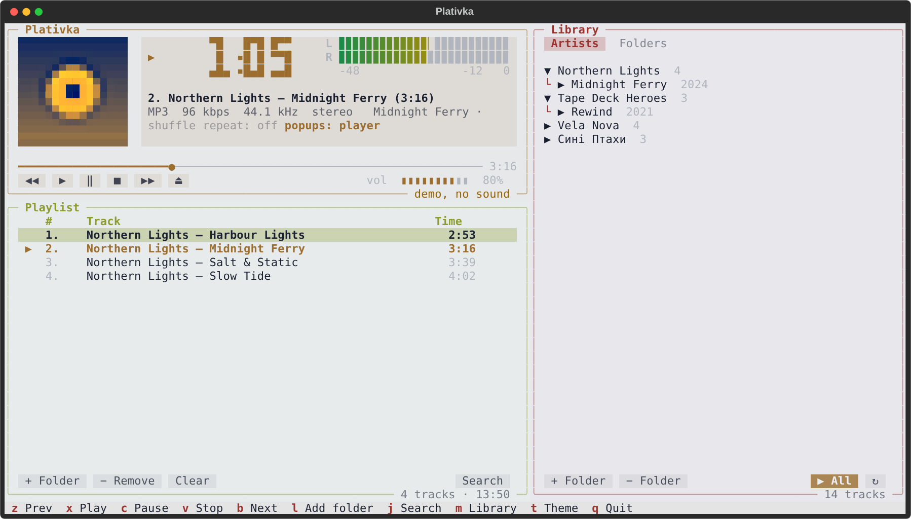
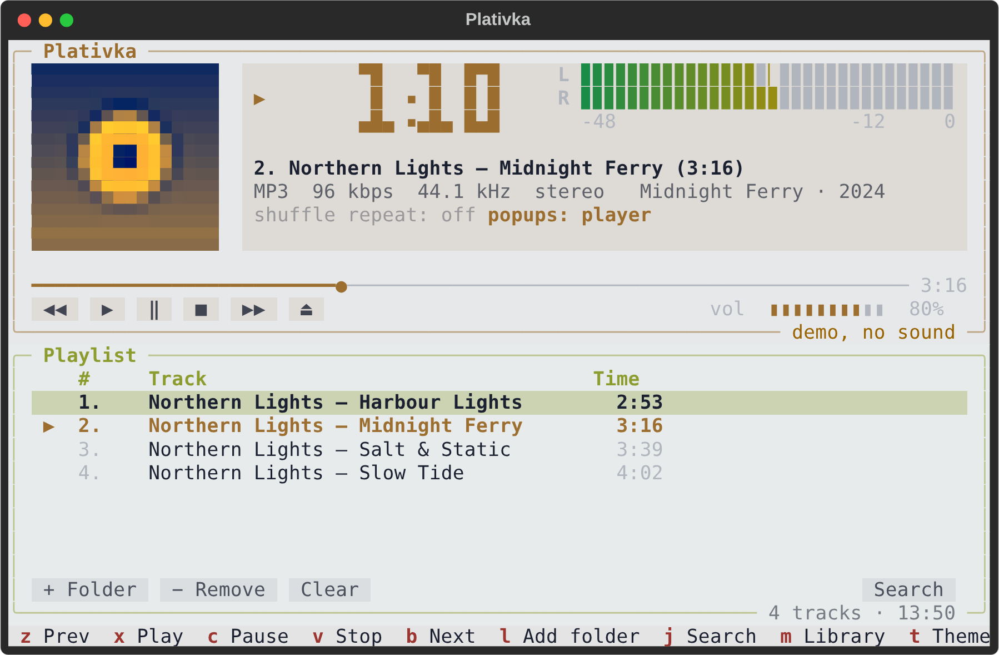

<p align="center">
  
</p>

<h1 align="center">Plativka</h1>

<p align="center">
  A Winamp-style music player that lives in your terminal.<br>
  macOS · Windows · Linux — offline, fast, no account, no ads.
</p>

<p align="center">
  <b>English</b> · <a href="README.uk.md">Українська</a>
</p>

<p align="center">
  <a href="https://github.com/dkindratyuk-web/plativka/releases/latest"><b>⬇ Download the latest release</b></a>
</p>



## Why

Plativka plays the music already on your disk — MP3 first of all, plus FLAC, M4A/AAC, OGG/Opus and WAV. It takes the layout everybody remembers from Winamp — a big main window with a time display and level meter, the playlist below it and the media library on the side — and puts it in a light, colourful terminal interface that uses almost no resources.

## Features

- **Winamp layout and keys**: main window, playlist, media library; `Z X C V B` for prev / play / pause / stop / next.
- **Folder-based library**: add folders (or just drag one into the window), browse by artist → album or by folder, search with `J`.
- **The interface takes its colour from the album cover** that is playing. Real cover art in terminals that can draw images (Kitty, Ghostty, iTerm2, WezTerm, Windows Terminal); a pixel-art cover elsewhere, or a spinning record if you turn covers off.
- **Real level meter** taken from the audio stream, a big LCD-style clock, a scrolling title.
- **Track popups**: in the player or as system notifications.
- **System integration**: tray icon on Windows (play/pause, next, previous, quit), media keys and the desktop media widget on Linux (MPRIS), media keys on macOS.
- **Smart tags**: files without tags are read from their names ("01. Artist - Title.mp3"), old Windows-1251 tags are fixed automatically.
- **Remembers everything**: playlist, position, volume, theme and library survive restarts.
- **Two languages**: English and Ukrainian, picked from your system language (`F2` to switch).

## Download and install

| System | What to download | Guide |
|---|---|---|
| **macOS** (Apple Silicon) | `Plativka-…-macos-arm64.dmg` | [Install on macOS](docs/en/install-macos.md) |
| **macOS** (Intel) | `Plativka-…-macos-x86_64.dmg` | [Install on macOS](docs/en/install-macos.md) |
| **Windows 10/11** | `Plativka-…-windows-x64-setup.exe` | [Install on Windows](docs/en/install-windows.md) |
| **Linux** (Debian, Ubuntu, Mint, Fedora, Arch, openSUSE) | `plativka-…-linux.tar.gz` | [Install on Linux](docs/en/install-linux.md) |

Everything is on the [Releases page](https://github.com/dkindratyuk-web/plativka/releases/latest). The macOS and Windows installers include everything Plativka needs — you don't have to install anything else.

## Screenshots

| Dark theme | Covers off — a spinning record |
|---|---|
|  |  |

| Quick search (`J`) | Narrow window |
|---|---|
|  |  |

## Keys

| Key | Action |
|---|---|
| `Z` `X` `C` `V` `B` | previous · play · pause · stop · next (like Winamp) |
| `Space` | pause / resume |
| `←` `→` | seek 5 seconds |
| `+` `−` | volume |
| `S` / `R` | shuffle / repeat (off → all → one) |
| `J` or `/` | find a track |
| `L` | add a folder to the library |
| `Shift+P` | put the whole library in the playlist |
| `M` | show / hide the library |
| `O` | cover: normal → large → off (spinning record) |
| `N` | track popups: in the player → system → off |
| `T` | light / dark theme |
| `F2` | interface language (applies after restart) |
| `H` | hide to tray (Windows) |
| `Delete` | remove a track from the playlist |
| `Q` | quit |

In the library: `Enter` on a track plays its whole album, `P` plays the selected artist/album/folder, `A` adds it to the end of the playlist. The mouse works too.

## Documentation

- [Using Plativka](docs/en/usage.md) — library, playlist, covers, popups, tray, settings
- [Troubleshooting](docs/en/troubleshooting.md) — tracks that stop early, pauses from outside, empty covers, logs
- [Changelog](CHANGELOG.md)

## Building from source

```bash
git clone https://github.com/dkindratyuk-web/plativka
cd plativka
pipx install .       # or: python3 -m venv .venv && .venv/bin/pip install .
plativka            # needs mpv in PATH
plativka --demo     # look around without mpv and without sound
```

Releases are built by GitHub Actions: push a tag like `v1.0.1` and the DMGs, the Windows installer and the Linux archive appear on the Releases page.

## License

Plativka is released under the [MIT License](LICENSE). The installers also include [mpv](https://mpv.io) and, on macOS, [kitty](https://sw.kovidgoyal.net/kitty/) — both under the GPL; see [THIRD_PARTY_LICENSES.md](THIRD_PARTY_LICENSES.md).
