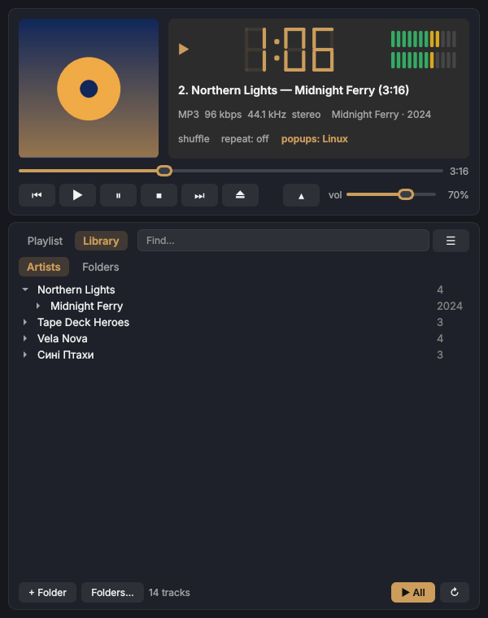
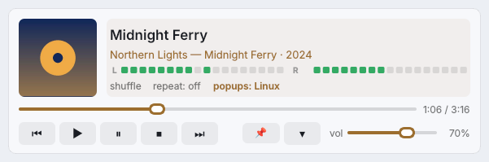
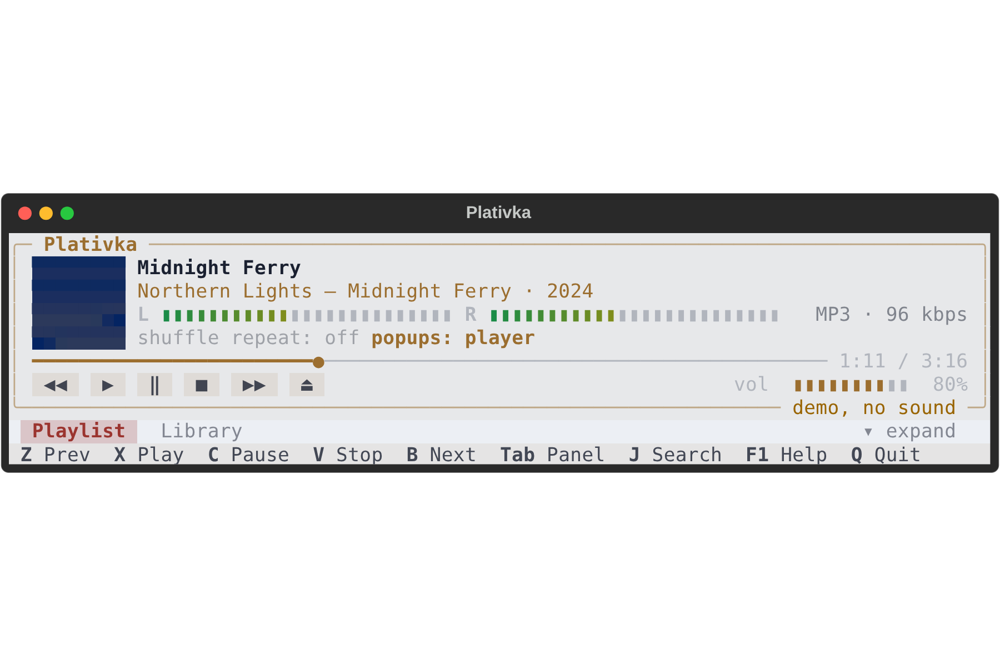
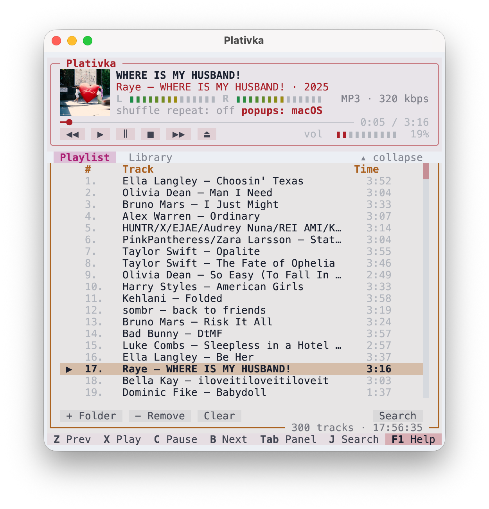
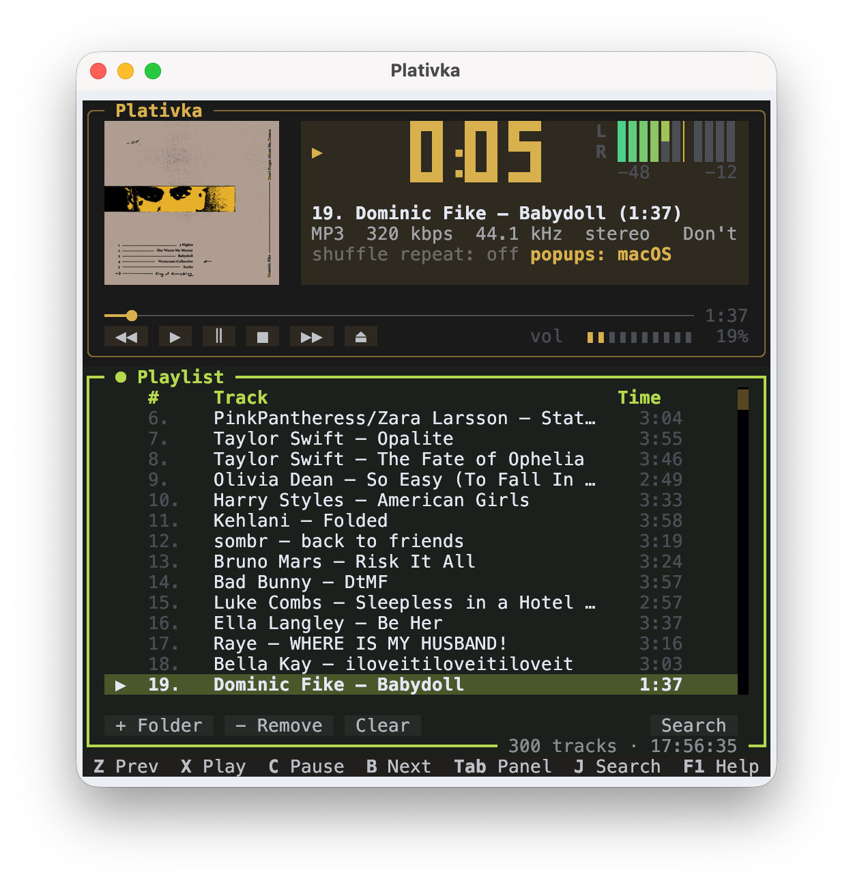

<p align="center">
  
</p>

<h1 align="center">Plativka</h1>

<p align="center">
  A Winamp-style music player that lives in your terminal.<br>
  macOS · Windows · Linux — offline, fast, no account, no ads.
</p>

<p align="center">
  <b>English</b> · <a href="README.uk.md">Українська</a>
</p>

<p align="center">
  <a href="https://github.com/dkindratyuk-web/plativka/releases/latest"><b>⬇ Download the latest release</b></a>
</p>


## Why

Plativka plays the music already on your disk — MP3 first of all, plus FLAC, M4A/AAC, OGG/Opus and WAV. It takes the layout everybody remembers from Winamp — a big main window with a time display and level meter, the playlist below it and the media library on the side — and puts it in a light, colourful terminal interface that uses almost no resources.

## Features

- **Winamp layout and keys**: main window, playlist, media library; `Z X C V B` for prev / play / pause / stop / next.
- **Compact view** (`W`): a small player strip with the playlist or the library in tabs below it; `E` collapses it to a mini player and shrinks the window.
- **Folder-based library**: add folders through the usual system folder dialog (or just drag one into the window), manage them in one **Folders…** window, browse by artist → album or by folder, search with `J`.
- **The interface takes its colour from the album cover** that is playing. Real cover art in terminals that can draw images (Kitty, Ghostty, iTerm2, WezTerm, Windows Terminal); a pixel-art cover elsewhere, or a spinning record if you turn covers off.
- **Real level meter** taken from the audio stream, a big LCD-style clock, a scrolling title.
- **Track popups**: in the player or as system notifications with the album cover.
- **System integration**: the volume keys on your keyboard (F11/F12 on a Mac) control the player — its volume mirrors the system volume; media keys ⏯ ⏭ ⏮ on all three systems (Windows media overlay, Linux MPRIS, macOS); tray icon on Windows.
- **Smart tags**: files without tags are read from their names ("01. Artist - Title.mp3"), old Windows-1251 tags are fixed automatically.
- **Remembers everything**: playlist, position, volume, theme and library survive restarts.
- **Two languages**: English and Ukrainian, picked from your system language (`F2` to switch).

## Download and install

| System | What to download | Guide |
|---|---|---|
| **macOS** (Apple Silicon) | `Plativka-…-macos-arm64.dmg` | [Install on macOS](docs/en/install-macos.md) |
| **macOS** (Intel) | `Plativka-…-macos-x86_64.dmg` | [Install on macOS](docs/en/install-macos.md) |
| **Windows 10/11** | `Plativka-…-windows-x64-setup.exe` | [Install on Windows](docs/en/install-windows.md) |
| **Linux** (Debian, Ubuntu, Mint, Fedora, Arch, openSUSE) | `plativka-…-linux.tar.gz` | [Install on Linux](docs/en/install-linux.md) |

Everything is on the [Releases page](https://github.com/dkindratyuk-web/plativka/releases/latest). The macOS and Windows installers include everything Plativka needs — you don't have to install anything else.

### New: Plativka Desktop (beta)

The same player in a regular window instead of a terminal — real album covers everywhere, a big LCD clock, the compact view and a mini player that can stay on top of other windows. On Windows 11 the window has the translucent Mica background. It shares the library with the terminal version.

| System | What to download |
|---|---|
| **macOS** | `Plativka-Desktop-…-macos-arm64.dmg` (Apple Silicon) or `…-macos-x86_64.dmg` (Intel) |
| **Windows 10/11** | `Plativka-Desktop-…-windows-x64-setup.exe` |
| **Linux** | the same `plativka-…-linux.tar.gz`, install with `./install.sh --desktop` |

<p>



</p>

Keys are the same as in the terminal version (`Z X C V B`, `Space`, `W` compact view, `E` mini player, `J` search, `T` theme). This is the first version — please report anything odd on the [Issues page](https://github.com/dkindratyuk-web/plativka/issues).

## Screenshots

| Dark theme | Covers off — a spinning record |
|---|---|
|  |  |

| Quick search (`J`) | Narrow window |
|---|---|
|  |  |

| Compact view (`W`) | Collapsed to a mini player (`E`) |
|---|---|
|  |  |

## On a real Mac

The macOS app (DMG) shows real album covers. Top row: the mini player (`W`, then `E`), the compact view with the playlist, the Winamp layout. Bottom row: the dark theme (`T`) — the colours follow each album cover.

<p>



</p>
<p>


</p>

## Keys

| Key | Action |
|---|---|
| `Z` `X` `C` `V` `B` | previous · play · pause · stop · next (like Winamp) |
| `Space` | pause / resume |
| `F7` `F8` `F9` | previous · pause · next (Mac media keys, also on keyboards that send them as plain F-keys) |
| `←` `→` | seek 5 seconds |
| `+` `−` | volume (same as the system volume keys) |
| `S` / `R` | shuffle / repeat (off → all → one) |
| `J` or `/` | find a track |
| `L` | add a folder to the library (system folder dialog) |
| `Shift+P` | put the whole library in the playlist |
| `M` | show / hide the library |
| `O` | cover: normal → large → off (spinning record) |
| `N` | track popups: in the player → system → off |
| `W` | view: Winamp ⇄ compact |
| `E` | compact view: collapse to a mini player / expand |
| `T` | light / dark theme |
| `F2` | interface language (applies after restart) |
| `H` | hide to tray (Windows) |
| `Delete` | remove a track from the playlist |
| `Tab` · `1` · `2` | switch between the playlist and the library (the active panel has a bold frame and ●) |
| `F1` or `?` | help: all keys, settings, link to GitHub |
| `Q` | quit |

In the library: `Enter` on a track plays its whole album, `P` plays the selected artist/album/folder, `A` adds it to the end of the playlist. The mouse works too.

## Documentation

- [Using Plativka](docs/en/usage.md) — library, playlist, covers, popups, tray, settings
- [Troubleshooting](docs/en/troubleshooting.md) — tracks that stop early, pauses from outside, empty covers, logs
- [Changelog](CHANGELOG.md)

## Building from source

```bash
git clone https://github.com/dkindratyuk-web/plativka
cd plativka
pipx install .       # or: python3 -m venv .venv && .venv/bin/pip install .
plativka            # needs mpv in PATH
plativka --demo     # look around without mpv and without sound
```

Releases are built by GitHub Actions: bump the version in `src/plativka/__init__.py`, then push a tag like `v1.0.1` (or push `main` to the `release` branch) — the DMGs, the Windows installer and the Linux archive appear on the Releases page.

## License

Plativka is released under the [MIT License](LICENSE). The installers also include [mpv](https://mpv.io) and, on macOS, [kitty](https://sw.kovidgoyal.net/kitty/) — both under the GPL; see [THIRD_PARTY_LICENSES.md](THIRD_PARTY_LICENSES.md).
