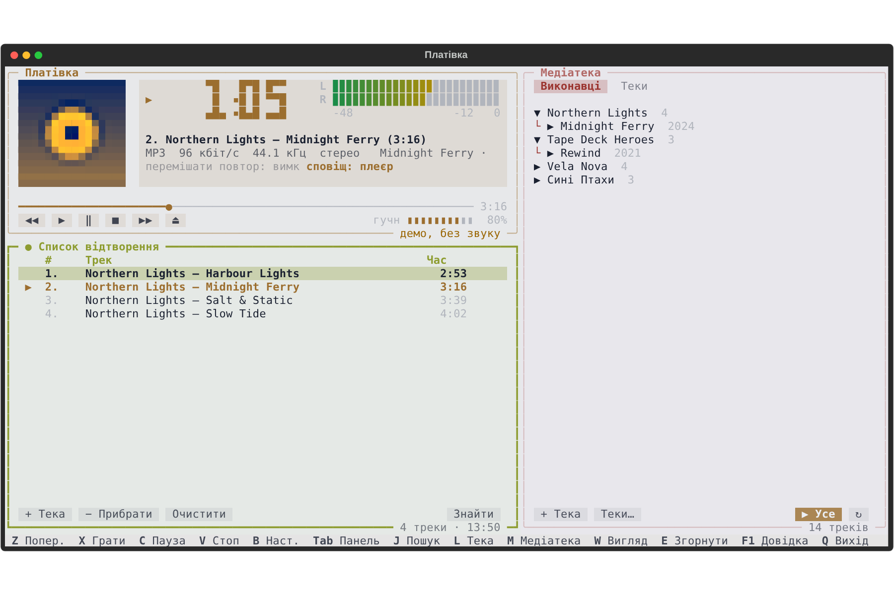
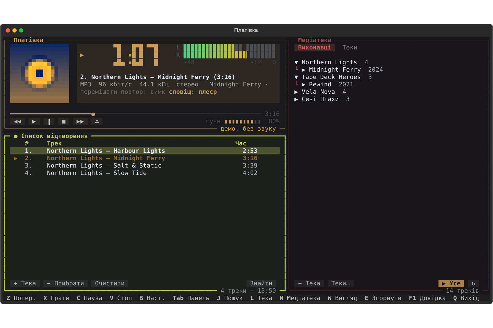
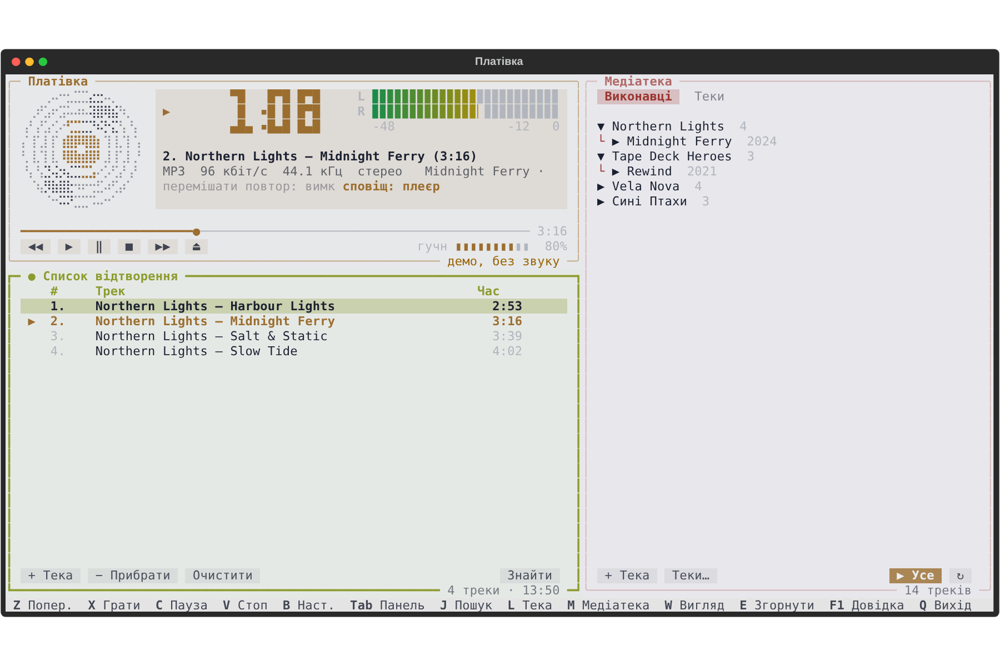
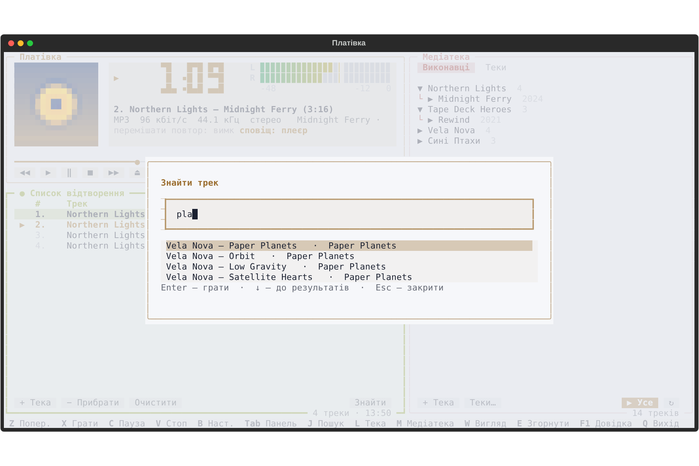
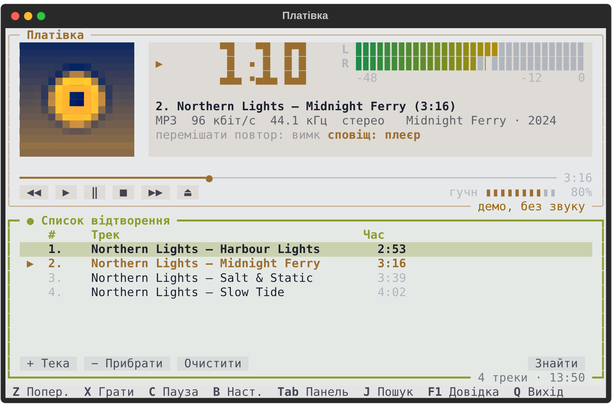
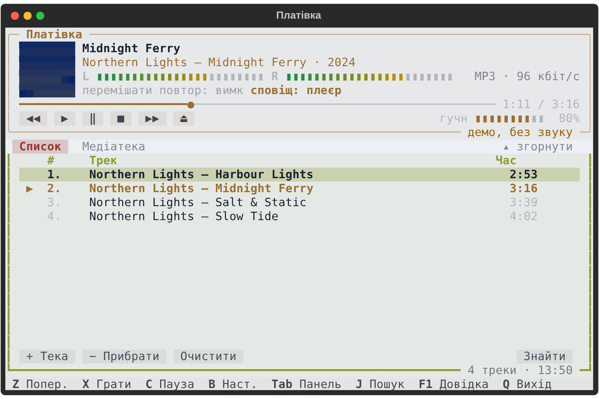
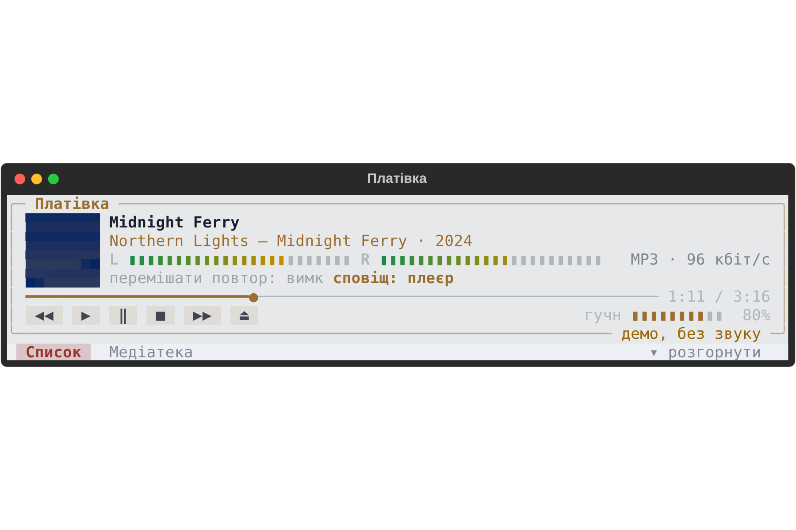
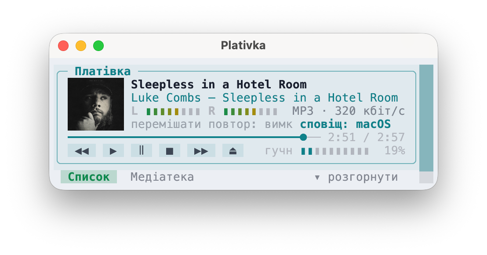
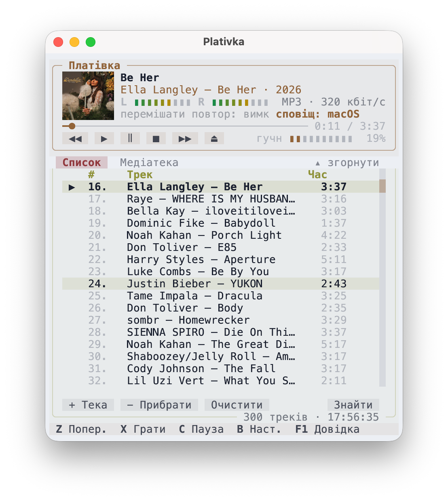
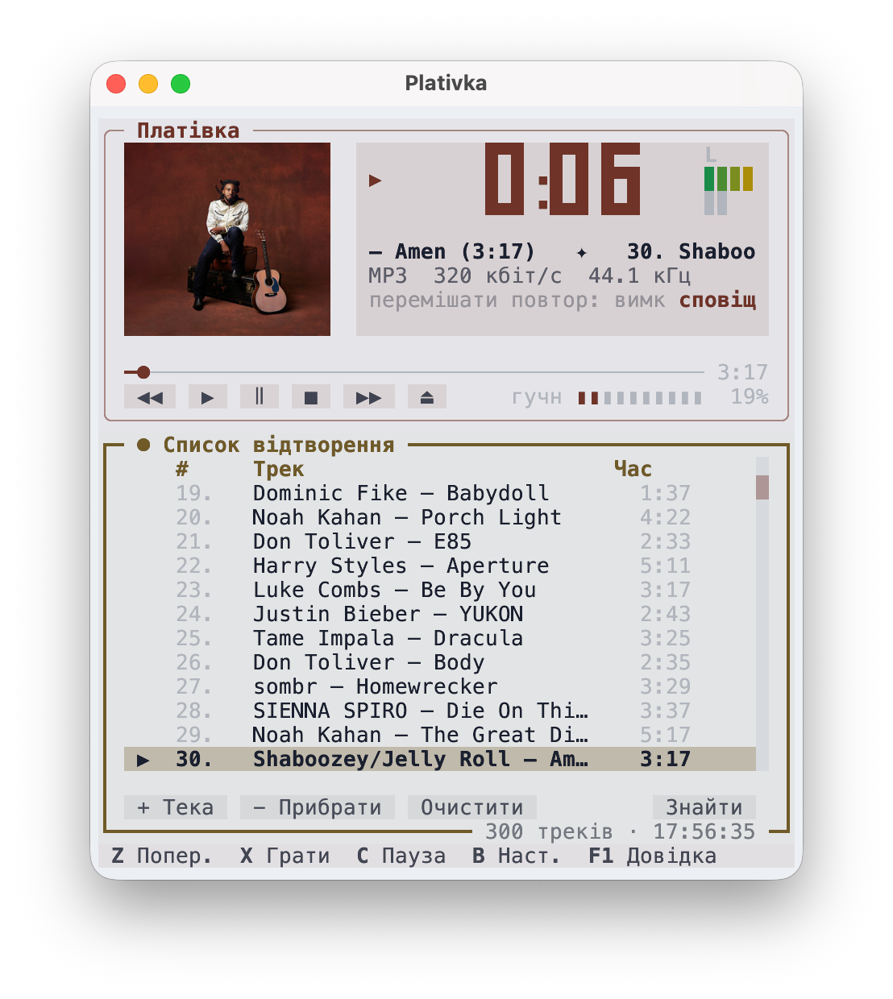

<p align="center">
  
</p>

<h1 align="center">Платівка</h1>

<p align="center">
  Музичний плеєр у дусі Winamp, що живе в терміналі.<br>
  macOS · Windows · Linux — офлайн, швидко, без акаунтів і реклами.
</p>

<p align="center">
  <a href="README.md">English</a> · <b>Українська</b>
</p>

<p align="center">
  <a href="https://github.com/dkindratyuk-web/plativka/releases/latest"><b>⬇ Завантажити останню версію</b></a>
</p>



## Навіщо

Платівка грає музику, яка вже є на вашому диску: насамперед MP3, а також FLAC, M4A/AAC, OGG/Opus і WAV. Вона бере знайому всім розкладку Winamp — велике головне вікно з годинником та індикатором рівня, список відтворення під ним і медіатеку збоку — і вкладає її в легкий кольоровий інтерфейс терміналу, що майже не їсть ресурсів.

## Можливості

- **Розкладка й клавіші Winamp**: головне вікно, список відтворення, медіатека; `Z X C V B` — назад / грати / пауза / стоп / далі.
- **Компактний вигляд** (`W`): невелика смужка плеєра, під нею список або медіатека у вкладках; `E` згортає його до міні-плеєра і зменшує вікно.
- **Медіатека з тек**: додавайте теки через звичайне системне вікно вибору (або просто перетягніть теку у вікно), керуйте ними в одному вікні **Теки…**, переглядайте за виконавцями → альбомами чи за теками, шукайте клавішею `J`.
- **Колір інтерфейсу береться з обкладинки** альбому, що грає. Справжні обкладинки в терміналах, які вміють малювати картинки (Kitty, Ghostty, iTerm2, WezTerm, Windows Terminal); «піксельна» обкладинка в інших або платівка, що крутиться, якщо обкладинки вимкнути.
- **Справжній індикатор рівня** з потоку звуку, великий годинник як на РК-дисплеї, біжучий рядок із назвою.
- **Сповіщення про трек**: у плеєрі або системні — з обкладинкою альбому.
- **Інтеграція з системою**: клавіші гучності на клавіатурі (F11/F12 на Mac) керують плеєром — його гучність дзеркалить системну; медіаклавіші ⏯ ⏭ ⏮ на всіх трьох системах (панель мультимедіа Windows, MPRIS на Linux, macOS); іконка в треї на Windows.
- **Розумні теги**: файли без тегів розбираються з імені («01. Виконавець - Назва.mp3»), старі теги в кодуванні Windows-1251 виправляються автоматично.
- **Усе пам'ятає**: список, позиція, гучність, тема й медіатека зберігаються між запусками.
- **Дві мови**: українська й англійська, обирається за мовою системи (`F2` — перемкнути).

## Завантаження і встановлення

| Система | Що завантажити | Інструкція |
|---|---|---|
| **macOS** (Apple Silicon) | `Plativka-…-macos-arm64.dmg` | [Встановлення на macOS](docs/uk/install-macos.md) |
| **macOS** (Intel) | `Plativka-…-macos-x86_64.dmg` | [Встановлення на macOS](docs/uk/install-macos.md) |
| **Windows 10/11** | `Plativka-…-windows-x64-setup.exe` | [Встановлення на Windows](docs/uk/install-windows.md) |
| **Linux** (Debian, Ubuntu, Mint, Fedora, Arch, openSUSE) | `plativka-…-linux.tar.gz` | [Встановлення на Linux](docs/uk/install-linux.md) |

Усе лежить на [сторінці релізів](https://github.com/dkindratyuk-web/plativka/releases/latest). Інсталятори для macOS і Windows містять усе потрібне: окремо нічого встановлювати не треба.

## Скріншоти

| Темна тема | Обкладинки вимкнено — платівка крутиться |
|---|---|
|  |  |

| Швидкий пошук (`J`) | Вузьке вікно |
|---|---|
|  |  |

| Компактний вигляд (`W`) | Згорнуто до міні-плеєра (`E`) |
|---|---|
|  |  |

## На справжньому Mac

Програма для macOS (DMG) показує справжні обкладинки альбомів. Зліва направо: міні-плеєр (`W`, потім `E`), компактний вигляд зі списком і вигляд Winamp у вузькому вікні.

<p>



</p>

## Клавіші

| Клавіша | Дія |
|---|---|
| `Z` `X` `C` `V` `B` | назад · грати · пауза · стоп · далі (як у Winamp) |
| `Пробіл` | пауза / продовжити |
| `F7` `F8` `F9` | назад · пауза · далі (медіаклавіші Mac, навіть на клавіатурах, що шлють їх як звичайні F-клавіші) |
| `←` `→` | перемотати на 5 секунд |
| `+` `−` | гучність (те саме, що системні клавіші гучності) |
| `S` / `R` | перемішування / повтор (вимк → усе → один) |
| `J` або `/` | знайти трек |
| `L` | додати теку до медіатеки (системне вікно вибору) |
| `Shift+P` | уся медіатека в список відтворення |
| `M` | показати / сховати медіатеку |
| `O` | обкладинка: звичайна → велика → вимкнена (платівка) |
| `N` | сповіщення про трек: у плеєрі → системні → вимк |
| `W` | вигляд: Winamp ⇄ компактний |
| `E` | компактний вигляд: згорнути до міні-плеєра / розгорнути |
| `T` | світла / темна тема |
| `F2` | мова інтерфейсу (після перезапуску) |
| `H` | сховати в трей (Windows) |
| `Delete` | прибрати трек зі списку |
| `Tab` · `1` · `2` | перейти між списком і медіатекою (активна панель — з жирною рамкою й ●) |
| `F1` або `?` | довідка: усі клавіші, налаштування, посилання на GitHub |
| `Q` | вийти |

У медіатеці: `Enter` на треку грає весь його альбом, `P` грає обраного виконавця/альбом/теку, `A` додає їх у кінець списку. Мишка теж працює.

## Документація

- [Як користуватися](docs/uk/usage.md) — медіатека, список, обкладинки, сповіщення, трей, налаштування
- [Якщо щось не так](docs/uk/troubleshooting.md) — треки обриваються, пауза ззовні, порожня обкладинка, журнали
- [Історія змін](CHANGELOG.md)

## Збирання з вихідного коду

```bash
git clone https://github.com/dkindratyuk-web/plativka
cd plativka
pipx install .       # або: python3 -m venv .venv && .venv/bin/pip install .
plativka            # потрібен mpv у PATH
plativka --demo     # роздивитися без mpv і без звуку
```

Релізи збирає GitHub Actions: підніміть версію в `src/plativka/__init__.py` і запуште тег на кшталт `v1.0.1` (або запуште `main` у гілку `release`) — DMG, інсталятор для Windows та архів для Linux з'являться на сторінці релізів.

## Ліцензія

Платівка поширюється за [ліцензією MIT](LICENSE). Інсталятори також містять [mpv](https://mpv.io) і (на macOS) [kitty](https://sw.kovidgoyal.net/kitty/) — обидва за GPL; див. [THIRD_PARTY_LICENSES.md](THIRD_PARTY_LICENSES.md).
