<p align="center">
  
</p>

<h1 align="center">Платівка</h1>

<p align="center">
  Музичний плеєр у дусі Winamp для macOS, Windows і Linux —<br>
  у власному вікні або просто в терміналі. Офлайн, швидкий, без акаунтів і реклами.
</p>

<p align="center">
  <a href="README.md">English</a> · <b>Українська</b>
</p>

<p align="center">
  <a href="https://github.com/dkindratyuk-web/plativka/releases/latest"><b>⬇ Завантажити останню версію</b></a> · <a href="https://dkindratyuk-web.github.io/plativka/uk/">Сайт</a>
</p>

<p align="center">
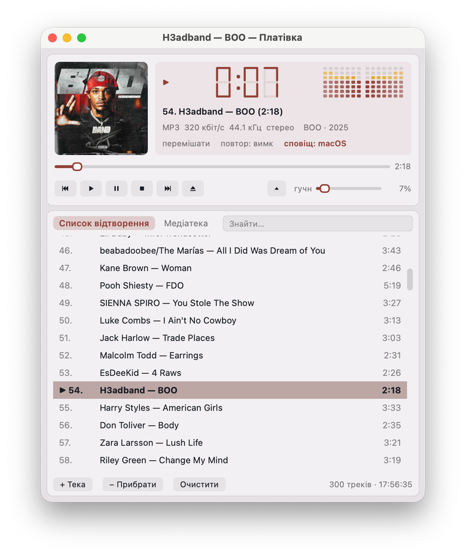
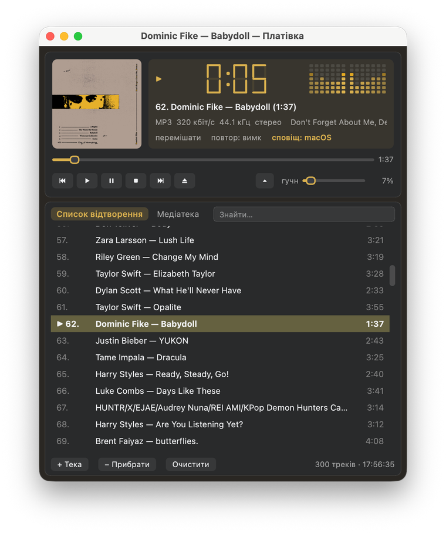
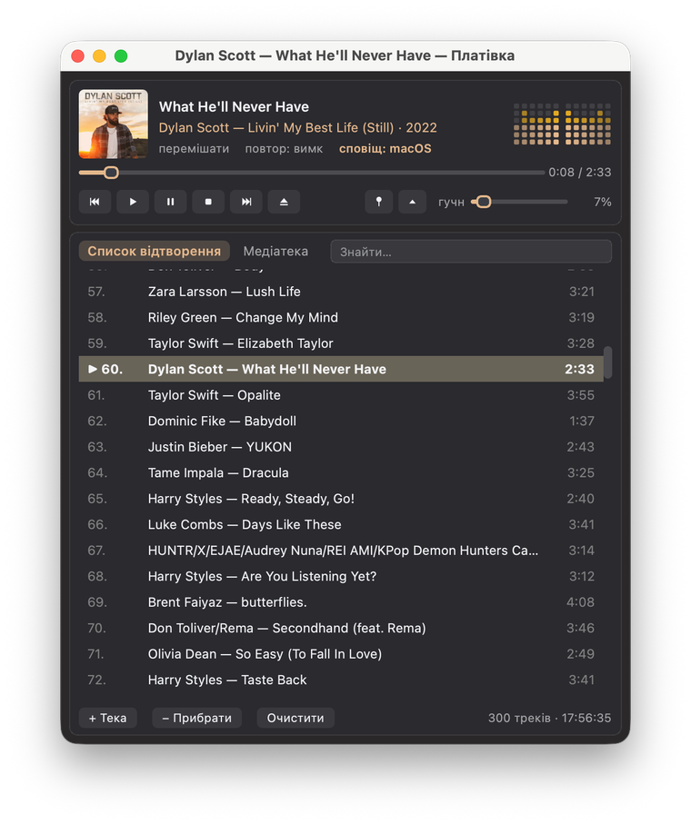
</p>

Платівка грає музику, яка вже є на вашому диску, — передусім MP3, а також FLAC, M4A/AAC, OGG/Opus і WAV. Вона бере знайому всім розкладку Winamp — головне вікно з великим годинником та індикатором рівня, список відтворення й медіатеку — і робить її легкою, кольоровою та швидкою.

Є дві версії — можна поставити одну або обидві; під час першого запуску віконна Платівка підхоплює теки з музикою і список відтворення з консольної:

| | **Віконна Платівка** (основна) | **Платівка для термінала** |
|---|---|---|
| Як виглядає | звичайне вікно програми | текстовий інтерфейс у вікні термінала |
| Обкладинки | справжні на всіх системах | справжні в kitty, Ghostty, iTerm2, WezTerm; «піксельні» в інших |
| Міні-плеєр | маленьке вікно, може бути поверх усіх | згортає вікно термінала |
| Для кого | для всіх | для тих, хто живе в терміналі |

---

## Віконна Платівка

### Що вміє

- **Розкладка Winamp**: обкладинка, годинник-табло, візуалізація звуку, назва й формат, перемикачі «перемішати / повтор / сповіщення», смуга перемотування, кнопки й гучність — а під ними список відтворення й медіатека.
- **Колір береться з обкладинки**: годинник, візуалізація, фон вікна, панелі й виділений трек змінюються з кожним альбомом. Світла, темна або системна тема (`T`).
- **Візуалізація звуку**: вертикальні «світлодіодні» стовпчики — ліворуч лівий канал, праворуч правий, посередині те, що грає зараз, а до країв — останні секунди, що поступово блякнуть.
- **Три розміри**: повний вигляд Winamp, **компактний** (`W`) з маленькою обкладинкою й великою назвою та **міні-плеєр** (`E`) — лише смужка плеєра, яку можна закріпити поверх усіх вікон (📌).
- **Список і медіатека** у вкладках з миттєвим пошуком (`J`): медіатека за виконавцями → альбомами або за теками, подвійний клік по треку грає весь альбом, правий клік — додати в кінець списку, `▶ Усе` — грати все.
- **Теки**: додаються звичайним системним вікном вибору або перетягуванням у вікно; у вікні **Теки…** — усі теки з кількістю треків.
- **Інтеграція з системою**: медіаклавіші ⏮ ⏯ ⏭ і кнопки навушників, «Зараз відтворюється» / панель мультимедіа Windows / MPRIS на Linux, сповіщення про трек **з обкладинкою**, іконка в треї, гучність дзеркалить системну (клавіші гучності на клавіатурі рухають повзунок).
- **Windows 11**: напівпрозорий фон Mica, підфарбований кольором обкладинки.
- **Розумні теги**: файли без тегів розбираються з імені («01. Виконавець - Назва.mp3»), старі теги в кодуванні Windows-1251 виправляються автоматично.
- **Усе пам'ятає**: список, позицію, гучність, вигляд, розмір вікна й медіатеку.
- **Українська й англійська**, обирається за мовою системи.

### Знімки

Те саме вікно на всіх трьох системах — знімки з macOS, Windows 11 і Linux.

**macOS** — повний вигляд, компактний і міні-плеєр у світлій і темній темі:

<p>

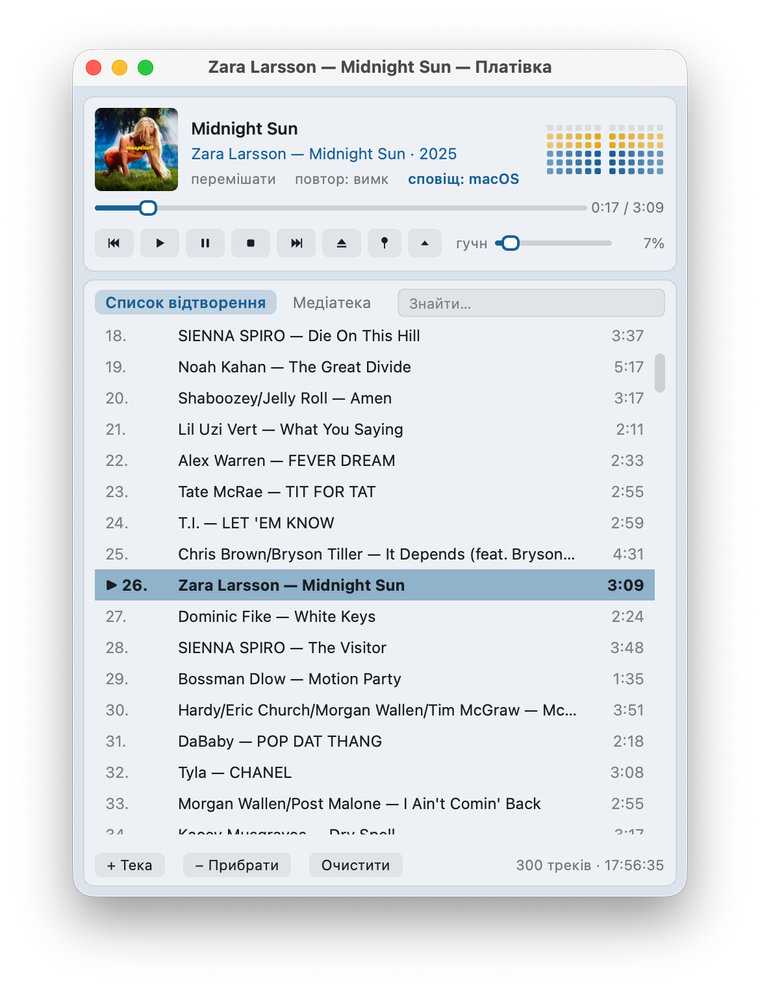

</p>
<p>
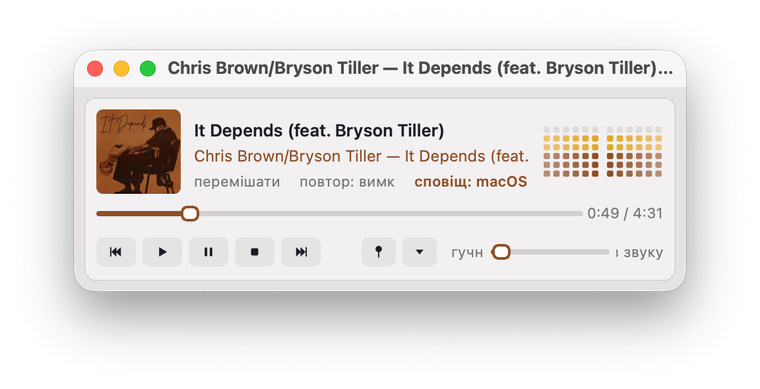
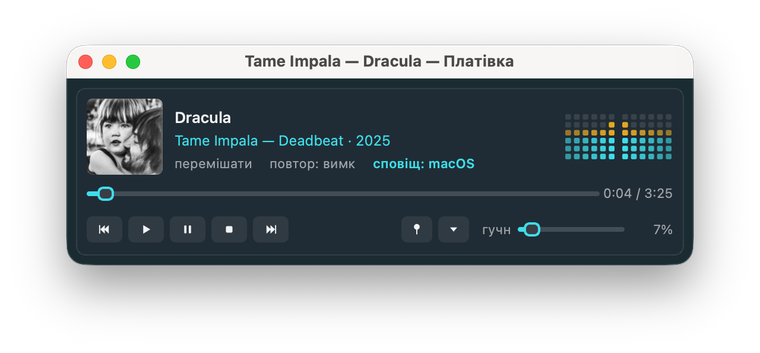
</p>

**Windows 11** — крізь фон Mica просвічують шпалери (знімки з англійським інтерфейсом):

<p>
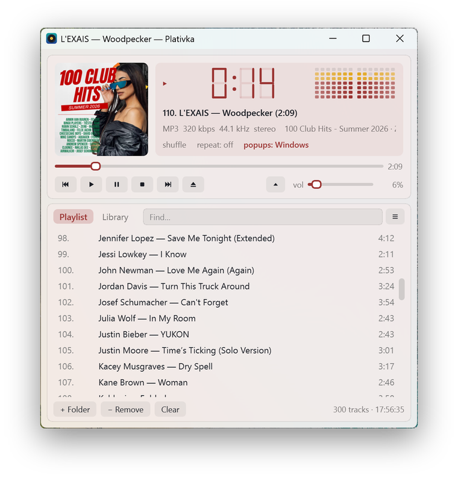
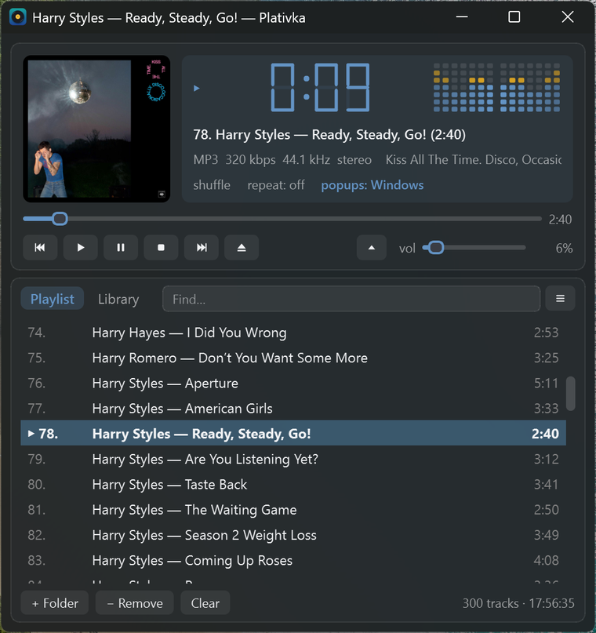
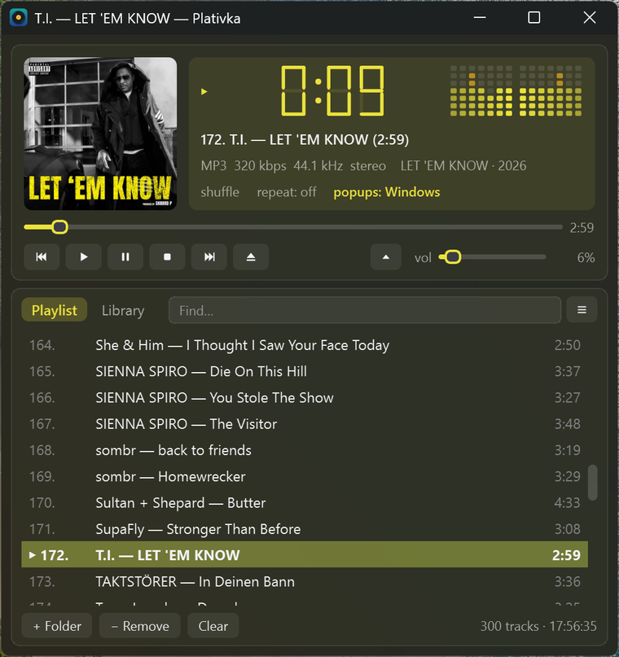
</p>
<p>
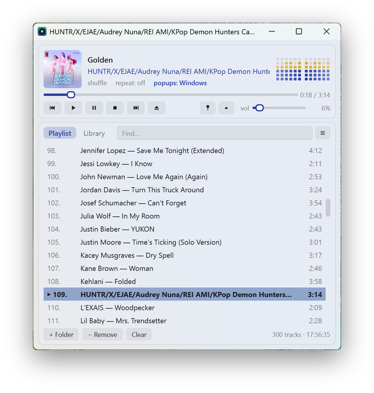
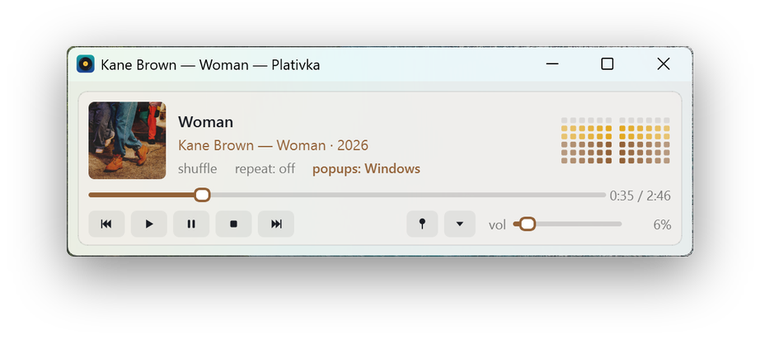
</p>

**Linux** — Kubuntu 26.10 з KDE Plasma:

<p>
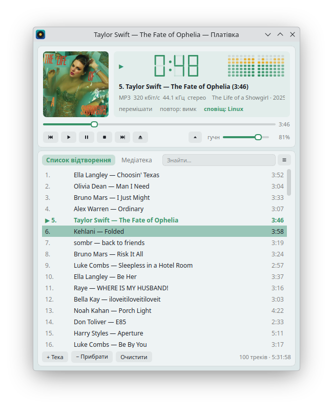
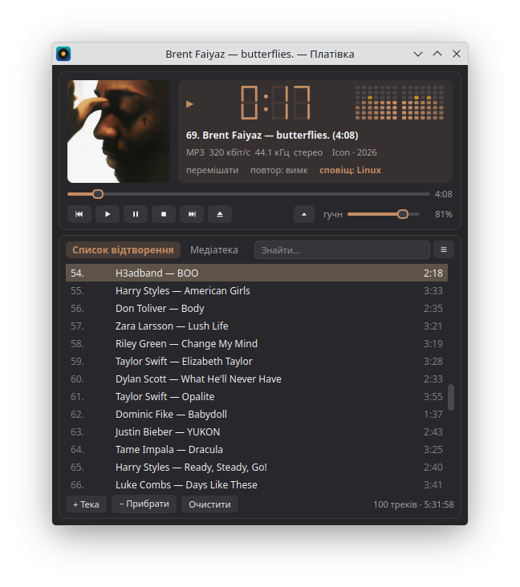
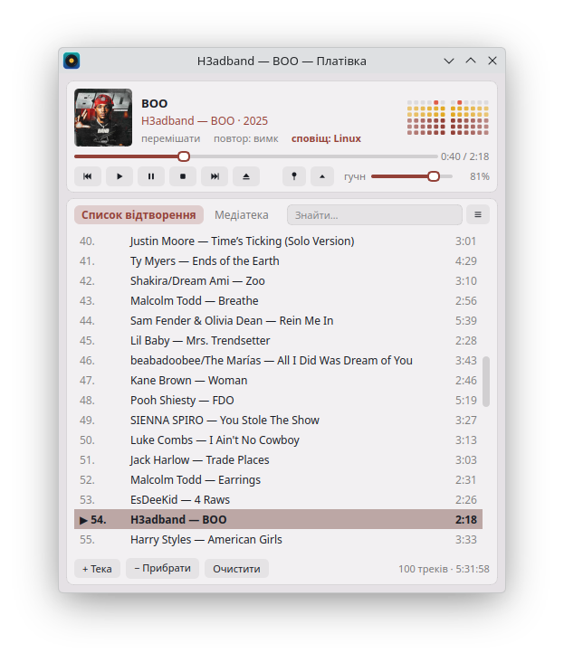
</p>
<p>
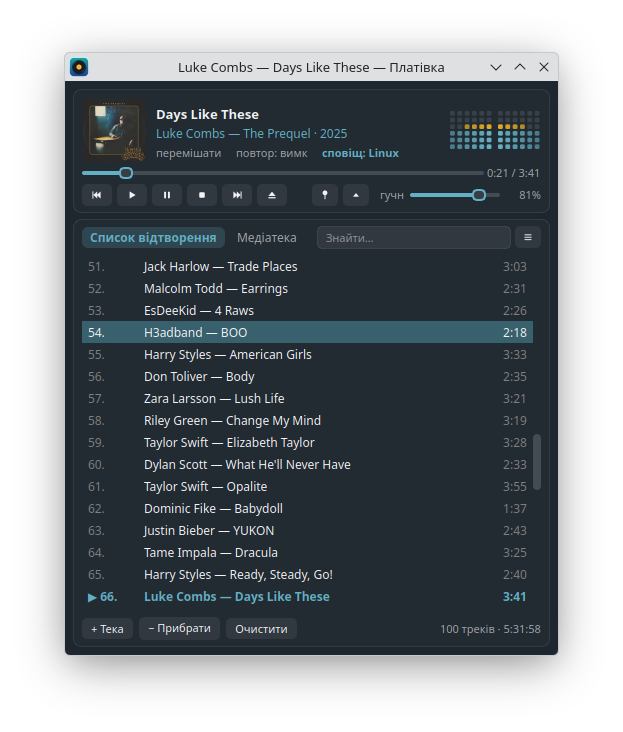
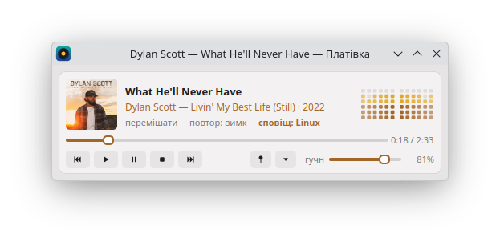
</p>

### Завантаження і встановлення

| Система | Що завантажити |
|---|---|
| **macOS** (Apple Silicon) | `Plativka-Desktop-…-macos-arm64.dmg` |
| **macOS** (Intel) | `Plativka-Desktop-…-macos-x86_64.dmg` |
| **Windows 10/11** | `Plativka-Desktop-…-windows-x64-setup.exe` |
| **Linux** (Debian, Ubuntu, Kubuntu, Mint, Fedora, Arch, openSUSE) | `plativka-…-linux.tar.gz`, далі `./install.sh --desktop` |

Усе лежить на [сторінці релізів](https://github.com/dkindratyuk-web/plativka/releases/latest); інсталятори для macOS і Windows містять усе потрібне, разом зі звуковим рушієм mpv. На macOS перший запуск треба один раз підтвердити: «Системні параметри → Приватність і безпека → Усе одно відкрити» ([докладно](docs/uk/install-macos.md)); Windows може показати «Захист ОС Windows» → «Докладніше» → «Усе одно запустити» ([докладно](docs/uk/install-windows.md)). Linux: [інструкція](docs/uk/install-linux.md).

### Клавіші

| Клавіша | Дія |
|---|---|
| `Пробіл` або `X` | грати / пауза |
| `Z` · `B` (або `F7` · `F9`) | попередній · наступний трек |
| `V` · `C` | стоп · пауза |
| `←` `→` | перемотати на 5 секунд |
| `+` `−` | гучність (те саме, що системні клавіші гучності) |
| `S` · `R` | перемішування · повтор (вимк → усе → один) |
| `J`, `/` або `Ctrl+F` | пошук у списку чи медіатеці |
| `Tab` · `1` · `2` | перейти між списком і медіатекою |
| `L` | додати теку до медіатеки |
| `W` | повний вигляд ⇄ компактний |
| `E` | міні-плеєр / розгорнути |
| `Ctrl+T` | вікно поверх усіх |
| `N` | сповіщення про трек увімк / вимк |
| `T` | тема: системна → світла → темна |
| `Delete` | прибрати виділені треки зі списку |
| `F1` | про Платівку |
| `Q` або `Ctrl+Q` (`⌘Q` на Mac) | вийти |

Усе це є й у меню: на macOS — у рядку меню вгорі екрана, на Windows і Linux — за кнопкою ☰.

---

## Платівка для термінала

Перша версія Платівки: той самий плеєр як текстовий інтерфейс у вікні термінала. Легка як пір'їнка й працює навіть через SSH. На macOS і Linux відкривається у власному вікні kitty зі справжніми обкладинками; в інших терміналах обкладинки малюються кольоровими квадратиками або їх замінює платівка, що крутиться.

### Завантаження і встановлення

| Система | Що завантажити | Інструкція |
|---|---|---|
| **macOS** (Apple Silicon) | `Plativka-…-macos-arm64.dmg` | [Встановлення на macOS](docs/uk/install-macos.md) |
| **macOS** (Intel) | `Plativka-…-macos-x86_64.dmg` | [Встановлення на macOS](docs/uk/install-macos.md) |
| **Windows 10/11** | `Plativka-…-windows-x64-setup.exe` | [Встановлення на Windows](docs/uk/install-windows.md) |
| **Linux** | `plativka-…-linux.tar.gz`, далі `./install.sh` (лише ця версія) або `./install.sh --desktop` (обидві) | [Встановлення на Linux](docs/uk/install-linux.md) |

### Знімки

<p>


</p>

| Темна тема | Обкладинки вимкнено — платівка крутиться |
|---|---|
|  |  |

| Швидкий пошук (`J`) | Компактний вигляд (`W`) |
|---|---|
|  |  |

### Клавіші

| Клавіша | Дія |
|---|---|
| `Z` `X` `C` `V` `B` | назад · грати · пауза · стоп · далі (як у Winamp) |
| `Пробіл` | пауза / продовжити |
| `F7` `F8` `F9` | назад · пауза · далі (медіаклавіші Mac, навіть на клавіатурах, що шлють їх як звичайні F-клавіші) |
| `←` `→` | перемотати на 5 секунд |
| `+` `−` | гучність (те саме, що системні клавіші гучності) |
| `S` / `R` | перемішування / повтор (вимк → усе → один) |
| `J` або `/` | знайти трек |
| `L` | додати теку до медіатеки (системне вікно вибору) |
| `Shift+P` | уся медіатека в список відтворення |
| `M` | показати / сховати медіатеку |
| `O` | обкладинка: звичайна → велика → вимкнена (платівка) |
| `N` | сповіщення про трек: у плеєрі → системні → вимк |
| `W` | вигляд: Winamp ⇄ компактний |
| `E` | компактний вигляд: згорнути до міні-плеєра / розгорнути |
| `T` | світла / темна тема |
| `F2` | мова інтерфейсу (після перезапуску) |
| `H` | сховати в трей (Windows) |
| `Delete` | прибрати трек зі списку |
| `Tab` · `1` · `2` | перейти між списком і медіатекою (активна панель — з жирною рамкою й ●) |
| `F1` або `?` | довідка: усі клавіші, налаштування, посилання на GitHub |
| `Q` | вийти |

У медіатеці: `Enter` на треку грає весь його альбом, `P` грає обраного виконавця/альбом/теку, `A` додає їх у кінець списку. Мишка теж працює.

## Документація

- [Як користуватися віконною Платівкою](docs/uk/desktop.md) — вигляди, медіатека, список, сповіщення, трей, налаштування
- [Платівка для термінала](docs/uk/terminal.md) — що це, як запустити, термінали й обкладинки, клавіші
- [Якщо щось не так](docs/uk/troubleshooting.md) — треки обриваються, пауза ззовні, порожня обкладинка, журнали
- [Історія змін](CHANGELOG.md)

## Збирання з вихідного коду

```bash
git clone https://github.com/dkindratyuk-web/plativka
cd plativka
pipx install .       # або: python3 -m venv .venv && .venv/bin/pip install .
plativka            # потрібен mpv у PATH
plativka --demo     # роздивитися без mpv і без звуку
```

Віконна версія: `pipx install ".[desktop]"`, потім `plativka-desktop` (або `plativka-desktop --demo`).


## Ліцензія

Платівка поширюється за [ліцензією MIT](LICENSE). Інсталятори також містять [mpv](https://mpv.io) (GPL), віконна версія використовує [Qt / PySide6](https://www.qt.io/qt-for-python) (LGPL), а консольна на macOS містить [kitty](https://sw.kovidgoyal.net/kitty/) (GPL); див. [THIRD_PARTY_LICENSES.md](THIRD_PARTY_LICENSES.md).
