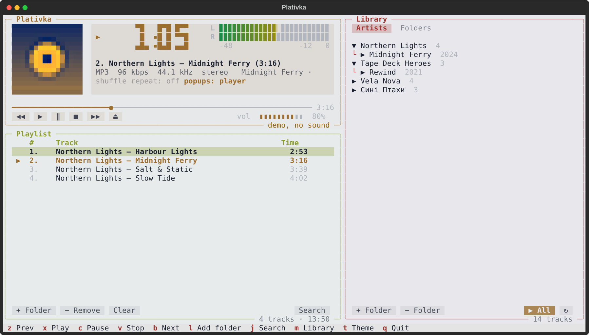

**Plativka 1.0.0** — the first public release of a Winamp-style music player for the terminal.
**Платівка 1.0.0** — перший публічний реліз музичного плеєра в дусі Winamp для терміналу.

## Download / Завантажити

| | File / Файл | Guide / Інструкція |
|---|---|---|
| macOS · Apple Silicon | `Plativka-1.0.0-macos-arm64.dmg` | [EN](https://github.com/dkindratyuk-web/plativka/blob/main/docs/en/install-macos.md) · [UA](https://github.com/dkindratyuk-web/plativka/blob/main/docs/uk/install-macos.md) |
| macOS · Intel | `Plativka-1.0.0-macos-x86_64.dmg` | [EN](https://github.com/dkindratyuk-web/plativka/blob/main/docs/en/install-macos.md) · [UA](https://github.com/dkindratyuk-web/plativka/blob/main/docs/uk/install-macos.md) |
| Windows 10/11 | `Plativka-1.0.0-windows-x64-setup.exe` | [EN](https://github.com/dkindratyuk-web/plativka/blob/main/docs/en/install-windows.md) · [UA](https://github.com/dkindratyuk-web/plativka/blob/main/docs/uk/install-windows.md) |
| Linux | `plativka-1.0.0-linux.tar.gz` | [EN](https://github.com/dkindratyuk-web/plativka/blob/main/docs/en/install-linux.md) · [UA](https://github.com/dkindratyuk-web/plativka/blob/main/docs/uk/install-linux.md) |

The macOS and Windows installers are not signed with paid certificates, so the system warns on first launch — the guides show the one-time step to allow it.
Інсталятори для macOS і Windows не підписані платними сертифікатами, тож система попередить при першому запуску — в інструкціях показано, як дозволити запуск (один раз).

## Highlights

- Winamp layout and keys (`Z X C V B`), folder library, quick search, drag and drop.
- Colours follow the album cover; real covers where the terminal supports images.
- Tray icon on Windows, MPRIS media keys on Linux, media keys on macOS.
- English and Ukrainian interface.

## Головне

- Розкладка й клавіші Winamp (`Z X C V B`), медіатека з тек, швидкий пошук, перетягування.
- Кольори під обкладинку альбому; справжні обкладинки там, де термінал уміє картинки.
- Іконка в треї на Windows, медіаклавіші через MPRIS на Linux, медіаклавіші на macOS.
- Інтерфейс українською та англійською.

`SHA256SUMS.txt` contains checksums of all files. / Контрольні суми всіх файлів — у `SHA256SUMS.txt`.
