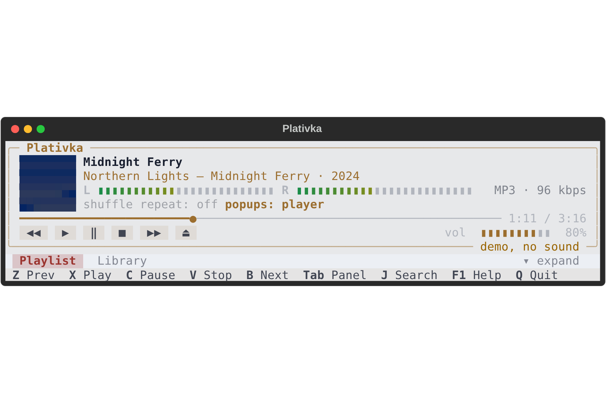

## What's new / Що нового

**English**

- **Compact view** (`W`), inspired by the Sonata player: a small player strip (cover, title, artist — album, one-line level meter, seek bar with time, buttons, volume) with the playlist and the library as tabs below.
- **Mini player** (`E`): collapses the compact view to the strip and shrinks the window (macOS DMG and Linux kitty window, the classic Windows console, Terminal.app, iTerm2, xterm); expanding restores the previous height.
- The view, tab and collapsed state are remembered. Linux: re-run the install script to let the window resize itself.

**Українська**

- **Компактний вигляд** (`W`), натхненний плеєром Sonata: невелика смужка плеєра (обкладинка, назва, виконавець — альбом, індикатор рівня в один рядок, смуга перемотування з часом, кнопки, гучність), під нею список і медіатека у вкладках.
- **Міні-плеєр** (`E`): згортає компактний вигляд до смужки й зменшує вікно (вікно Платівки на macOS і Linux, класична консоль Windows, Термінал macOS, iTerm2, xterm); розгортання повертає попередню висоту.
- Вигляд, вкладка й згорнутий стан запам'ятовуються. Linux: запустіть скрипт встановлення ще раз, щоб вікно могло саме змінювати розмір.

## Download / Завантажити

| | File / Файл |
|---|---|
| macOS · Apple Silicon | `Plativka-{{VERSION}}-macos-arm64.dmg` |
| macOS · Intel | `Plativka-{{VERSION}}-macos-x86_64.dmg` |
| Windows 10/11 | `Plativka-{{VERSION}}-windows-x64-setup.exe` |
| Linux | `plativka-{{VERSION}}-linux.tar.gz` |

Installation guides / Інструкції: [macOS](https://github.com/dkindratyuk-web/plativka/blob/main/docs/en/install-macos.md) · [Windows](https://github.com/dkindratyuk-web/plativka/blob/main/docs/en/install-windows.md) · [Linux](https://github.com/dkindratyuk-web/plativka/blob/main/docs/en/install-linux.md) — [українською](https://github.com/dkindratyuk-web/plativka/blob/main/README.uk.md#завантаження-і-встановлення)

Full history / Уся історія: [CHANGELOG.md](https://github.com/dkindratyuk-web/plativka/blob/main/CHANGELOG.md)
