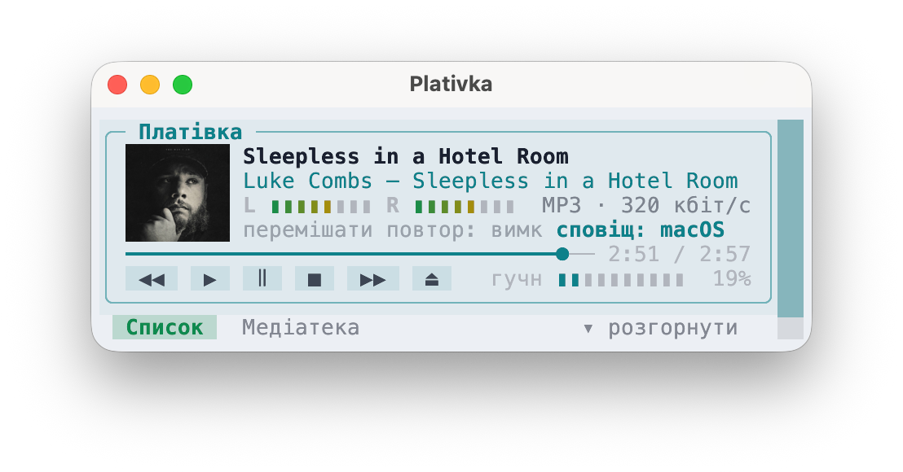

## What's new / Що нового

**English**

- Mini player: no scrollbar and no clipped tab row when the window comes out a row shorter than asked (kitty with padding); the key row is hidden in the mini player so the strip is one line shorter.
- Screenshots from a real Mac on the GitHub page.

**Українська**

- Міні-плеєр: більше немає смуги прокрутки й обрізаного рядка вкладок, коли вікно виходить на рядок нижчим, ніж просили (kitty з відступами); рядок клавіш у міні-плеєрі схований, тож смужка на рядок нижча.
- Знімки зі справжнього Mac на сторінці GitHub.

## Download / Завантажити

| | File / Файл |
|---|---|
| macOS · Apple Silicon | `Plativka-{{VERSION}}-macos-arm64.dmg` |
| macOS · Intel | `Plativka-{{VERSION}}-macos-x86_64.dmg` |
| Windows 10/11 | `Plativka-{{VERSION}}-windows-x64-setup.exe` |
| Linux | `plativka-{{VERSION}}-linux.tar.gz` |

Installation guides / Інструкції: [macOS](https://github.com/dkindratyuk-web/plativka/blob/main/docs/en/install-macos.md) · [Windows](https://github.com/dkindratyuk-web/plativka/blob/main/docs/en/install-windows.md) · [Linux](https://github.com/dkindratyuk-web/plativka/blob/main/docs/en/install-linux.md) — [українською](https://github.com/dkindratyuk-web/plativka/blob/main/README.uk.md#завантаження-і-встановлення)

Full history / Уся історія: [CHANGELOG.md](https://github.com/dkindratyuk-web/plativka/blob/main/CHANGELOG.md)
