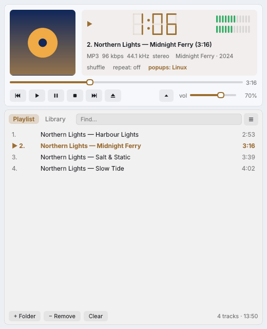

## What's new / Що нового

**English**

- Windows installers (both versions) close a running Plativka before updating, so the update no longer stops with "DeleteFile failed; code 5. Access is denied."

**Українська**

- Інсталятори для Windows (обидві версії) самі закривають запущену Платівку перед оновленням — більше немає помилки «DeleteFile збій; код 5. Access is denied».

## Download / Завантажити

| | Terminal version / Консольна | Desktop (beta) / Віконна (бета) |
|---|---|---|
| macOS · Apple Silicon | `Plativka-{{VERSION}}-macos-arm64.dmg` | `Plativka-Desktop-{{VERSION}}-macos-arm64.dmg` |
| macOS · Intel | `Plativka-{{VERSION}}-macos-x86_64.dmg` | `Plativka-Desktop-{{VERSION}}-macos-x86_64.dmg` |
| Windows 10/11 | `Plativka-{{VERSION}}-windows-x64-setup.exe` | `Plativka-Desktop-{{VERSION}}-windows-x64-setup.exe` |
| Linux | `plativka-{{VERSION}}-linux.tar.gz` → `./install.sh` | same archive → `./install.sh --desktop` |

The desktop DMG opens like the terminal one: the first time, allow it in System Settings → Privacy & Security → "Open Anyway". / Віконний DMG відкривається так само: першого разу дозвольте в «Системні параметри → Приватність і безпека → Усе одно відкрити».

Installation guides / Інструкції: [macOS](https://github.com/dkindratyuk-web/plativka/blob/main/docs/en/install-macos.md) · [Windows](https://github.com/dkindratyuk-web/plativka/blob/main/docs/en/install-windows.md) · [Linux](https://github.com/dkindratyuk-web/plativka/blob/main/docs/en/install-linux.md)
