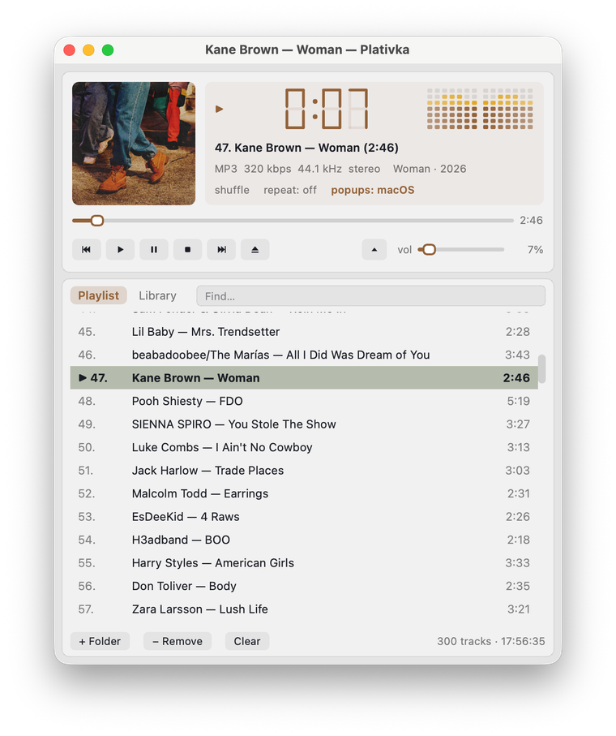

## What's new / Що нового

**English**

- Gapless playback: tracks follow each other without a pause, as on the album (both editions).
- Volume levelling with ReplayGain: by album (default), by track or off — Plativka Desktop: ☰ → Playback; terminal: `G`.
- Albums as one file with a `.cue` sheet (FLAC, APE, WAV, WavPack) are shown as separate tracks and play without gaps; `.cue` files in UTF-8 or Windows-1251.
- Sleep timer: 15–90 minutes or after the current track, with a fade-out — Plativka Desktop: ☰ → Playback → Sleep timer; terminal: `K`.
- Update check: once a day Plativka asks GitHub whether a new version is out and shows "⬆ 1.x.x" next to shuffle and repeat. Can be turned off.
- APE and WavPack files are now recognised.
- macOS: the app icon is now the same size as other icons in the Dock (it has the standard margins and shadow).

**Українська**

- Без пауз між треками (gapless): треки йдуть один за одним, як на альбомі (обидві версії).
- Вирівнювання гучності за ReplayGain: за альбомом (типово), за треком або вимкнено — у віконній версії ☰ → Відтворення, у консольній — `G`.
- Альбоми одним файлом з `.cue` (FLAC, APE, WAV, WavPack) показуються окремими треками й грають без пауз; `.cue` в UTF-8 або Windows-1251.
- Таймер сну: 15–90 хвилин або після поточного треку, з м'яким стишуванням — у віконній версії ☰ → Відтворення → Таймер сну, у консольній — `K`.
- Перевірка оновлень: раз на добу Платівка питає GitHub, чи вийшла нова версія, і показує «⬆ 1.x.x» поруч із перемішуванням і повтором. Можна вимкнути.
- Тепер розпізнаються файли APE і WavPack.
- macOS: іконка програми тепер такого ж розміру, як інші в доці (зі стандартними полями й тінню).

## Download / Завантажити

| | Terminal version / Консольна | Desktop / Віконна |
|---|---|---|
| macOS · Apple Silicon | `Plativka-{{VERSION}}-macos-arm64.dmg` | `Plativka-Desktop-{{VERSION}}-macos-arm64.dmg` |
| macOS · Intel | `Plativka-{{VERSION}}-macos-x86_64.dmg` | `Plativka-Desktop-{{VERSION}}-macos-x86_64.dmg` |
| Windows 10/11 | `Plativka-{{VERSION}}-windows-x64-setup.exe` | `Plativka-Desktop-{{VERSION}}-windows-x64-setup.exe` |
| Linux | `plativka-{{VERSION}}-linux.tar.gz` → `./install.sh` | same archive → `./install.sh --desktop` |

The desktop DMG opens like the terminal one: the first time, allow it in System Settings → Privacy & Security → "Open Anyway". / Віконний DMG відкривається так само: першого разу дозвольте в «Системні параметри → Приватність і безпека → Усе одно відкрити».

Installation guides / Інструкції: [macOS](https://github.com/dkindratyuk-web/plativka/blob/main/docs/en/install-macos.md) · [Windows](https://github.com/dkindratyuk-web/plativka/blob/main/docs/en/install-windows.md) · [Linux](https://github.com/dkindratyuk-web/plativka/blob/main/docs/en/install-linux.md)
