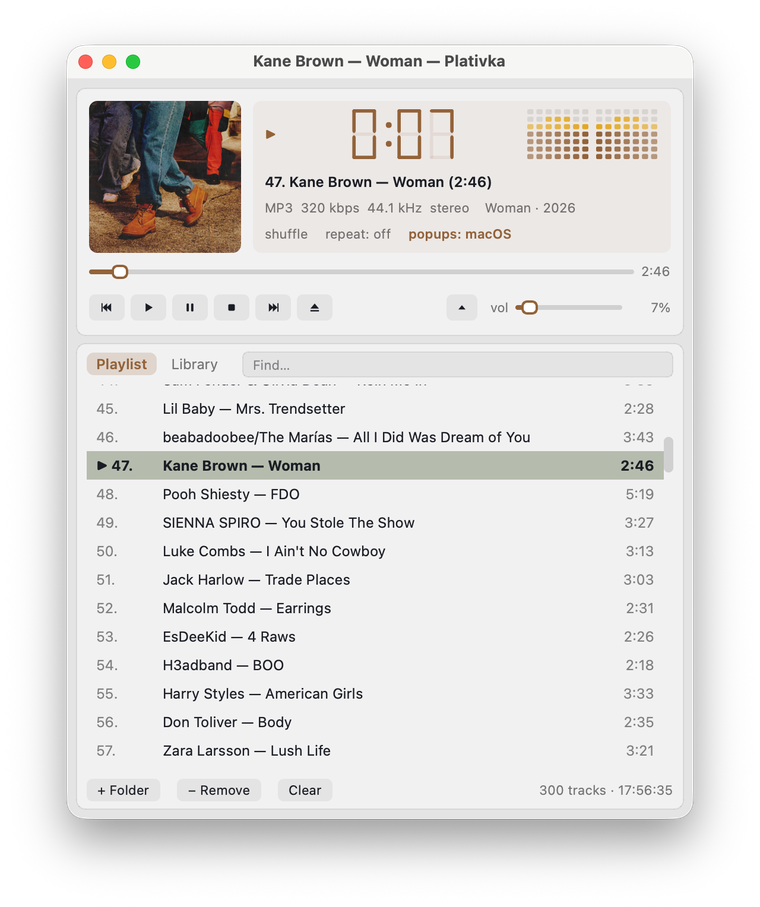

## What's new / Що нового

**English**

- Phone remote: control Plativka from a phone on the same Wi-Fi — scan the QR code, nothing to install. Pause, previous/next, seek, volume, sleep timer and any track from the playlist. Off until you turn it on; only phones you paired and only from your home network. Plativka Desktop: ☰ → Playback → Phone remote; terminal: `F3`.

**Українська**

- Пульт з телефона: керуйте Платівкою з телефона в тій самій Wi-Fi-мережі — відскануйте QR-код, нічого встановлювати не треба. Пауза, назад/далі, перемотування, гучність, таймер сну і будь-який трек зі списку. Вимкнено, доки ви не ввімкнете; лише телефони, які ви підключили, і лише з домашньої мережі. Віконна версія: ☰ → Відтворення → Пульт з телефона; консольна: `F3`.

**How to use / Як користуватися:** Plativka Desktop: ☰ → Playback → Phone remote… → tick “Allow control from a phone” → scan the QR code with the phone (same Wi-Fi). Terminal: `F3`, then `Space`. Віконна версія: ☰ → Відтворення → Пульт з телефона… → галочка «Дозволити керування з телефона» → відскануйте QR-код телефоном (та сама Wi-Fi-мережа). Консольна: `F3`, потім `Пробіл`. [Guide](https://github.com/dkindratyuk-web/plativka/blob/main/docs/en/desktop.md#phone-remote) · [Інструкція](https://github.com/dkindratyuk-web/plativka/blob/main/docs/uk/desktop.md#пульт-з-телефона)

## Download / Завантажити

| | Terminal version / Консольна | Desktop / Віконна |
|---|---|---|
| macOS · Apple Silicon | `Plativka-{{VERSION}}-macos-arm64.dmg` | `Plativka-Desktop-{{VERSION}}-macos-arm64.dmg` |
| macOS · Intel | `Plativka-{{VERSION}}-macos-x86_64.dmg` | `Plativka-Desktop-{{VERSION}}-macos-x86_64.dmg` |
| Windows 10/11 | `Plativka-{{VERSION}}-windows-x64-setup.exe` | `Plativka-Desktop-{{VERSION}}-windows-x64-setup.exe` |
| Linux | `plativka-{{VERSION}}-linux.tar.gz` → `./install.sh` | same archive → `./install.sh --desktop` |

The desktop DMG opens like the terminal one: the first time, allow it in System Settings → Privacy & Security → "Open Anyway". / Віконний DMG відкривається так само: першого разу дозвольте в «Системні параметри → Приватність і безпека → Усе одно відкрити».

Installation guides / Інструкції: [macOS](https://github.com/dkindratyuk-web/plativka/blob/main/docs/en/install-macos.md) · [Windows](https://github.com/dkindratyuk-web/plativka/blob/main/docs/en/install-windows.md) · [Linux](https://github.com/dkindratyuk-web/plativka/blob/main/docs/en/install-linux.md)
