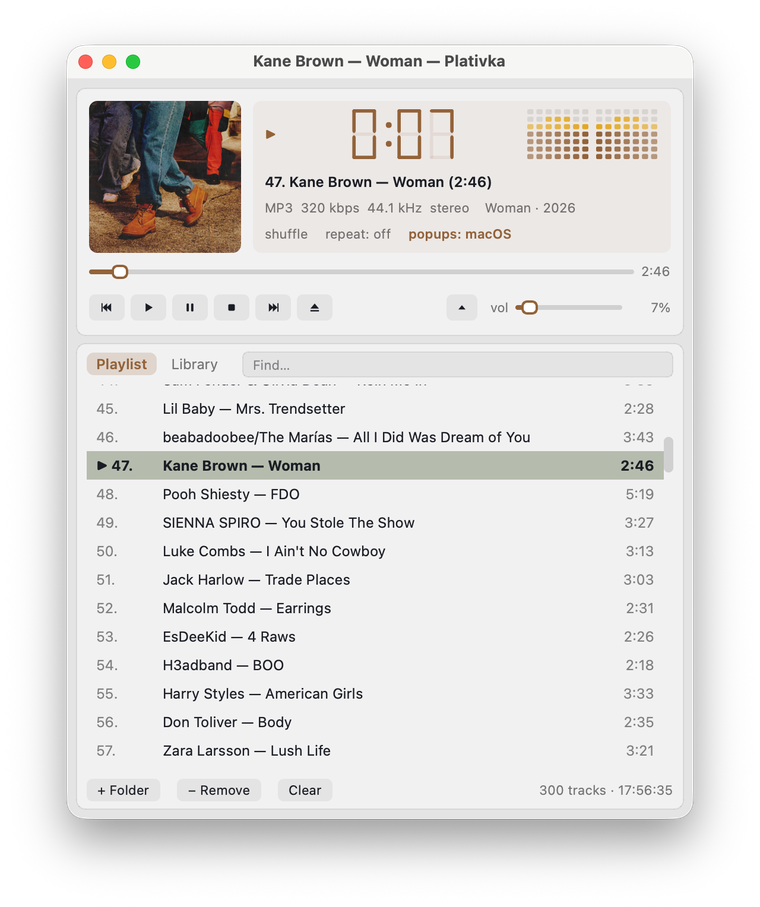

## What's new / Що нового

**English**

- Favorites: like a song with the ♡ in the playlist, `F`, the Favorites menu, the tray or the phone remote, and play only your favorites (`Shift+F` or **♥ Favorites** at the top of the library). A filled ♥ is shown only for liked songs; an empty ♡ only on the row under the mouse/cursor or the selected one.
- Likes survive moving and renaming files: after a library scan Plativka finds the song by artist, title and length and moves the like to the new place.
- Smart lists at the top of the library: Recently added, Most played, Not played for a while — from the play history kept only on your computer.
- Remove non-favorites: from the list only (the default) or from the list and the disk — to the Trash, never permanently; songs that haven't played yet are kept by default.
- Save favorites as an M3U playlist.

**Українська**

- Улюблені: вподобайте пісню сердечком ♡ у списку, клавішею `F`, з меню «Улюблені», трею чи пульта з телефона — і слухайте лише улюблені (`Shift+F` або **♥ Улюблені** нагорі медіатеки). Заповнене ♥ видно лише біля вподобаних; порожнє ♡ — лише на рядку під мишкою/курсором чи на виділеному.
- Лайки не губляться при перенесенні й перейменуванні файлів: після сканування медіатеки Платівка знаходить пісню за виконавцем, назвою й тривалістю й переносить лайк на нове місце.
- Розумні списки нагорі медіатеки: «Нещодавно додані», «Найчастіше слухаю», «Давно не звучали» — з історії прослуховувань, яка зберігається лише на вашому комп'ютері.
- «Прибрати неулюблені»: лише зі списку (за замовчуванням) або зі списку й з диска — у Кошик, ніколи назавжди; пісні, які ще не звучали, за замовчуванням лишаються.
- Зберегти улюблені як плейлист M3U.

**How to use / Як користуватися:** like — `F` or the ♡ in the playlist; play favorites — `Shift+F` or **♥ Favorites** at the top of the library; Plativka Desktop: the **Favorites** menu; terminal: `Shift+D` to remove non-favorites. Вподобати — `F` або ♡ у списку; слухати улюблені — `Shift+F` або **♥ Улюблені** нагорі медіатеки; віконна версія — меню **Улюблені**; консольна — `Shift+D`, щоб прибрати неулюблені. [Guide](https://github.com/dkindratyuk-web/plativka/blob/main/docs/en/desktop.md#favorites) · [Інструкція](https://github.com/dkindratyuk-web/plativka/blob/main/docs/uk/desktop.md#улюблені)

## Download / Завантажити

| | Terminal version / Консольна | Desktop / Віконна |
|---|---|---|
| macOS · Apple Silicon | `Plativka-{{VERSION}}-macos-arm64.dmg` | `Plativka-Desktop-{{VERSION}}-macos-arm64.dmg` |
| macOS · Intel | `Plativka-{{VERSION}}-macos-x86_64.dmg` | `Plativka-Desktop-{{VERSION}}-macos-x86_64.dmg` |
| Windows 10/11 | `Plativka-{{VERSION}}-windows-x64-setup.exe` | `Plativka-Desktop-{{VERSION}}-windows-x64-setup.exe` |
| Linux | `plativka-{{VERSION}}-linux.tar.gz` → `./install.sh` | same archive → `./install.sh --desktop` |

The desktop DMG opens like the terminal one: the first time, allow it in System Settings → Privacy & Security → "Open Anyway". / Віконний DMG відкривається так само: першого разу дозвольте в «Системні параметри → Приватність і безпека → Усе одно відкрити».

Installation guides / Інструкції: [macOS](https://github.com/dkindratyuk-web/plativka/blob/main/docs/en/install-macos.md) · [Windows](https://github.com/dkindratyuk-web/plativka/blob/main/docs/en/install-windows.md) · [Linux](https://github.com/dkindratyuk-web/plativka/blob/main/docs/en/install-linux.md)
