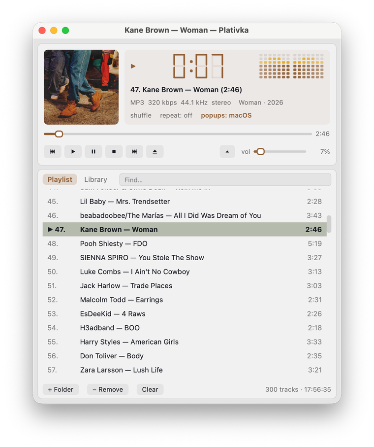

## What's new / Що нового

**English**

- **Play next**: `Shift+N` (or right-click → **Play next**) puts a song — or a whole album from the library — right after the current one, without reordering the playlist. Several songs can wait in the queue (marked →1, →2…); on the phone remote, touch and hold a song.
- **Copy to a USB stick** (☰ → File, terminal `Shift+C`): numbered file names so a car stereo keeps your order; the size and free space are shown first; nothing is overwritten without asking; names are safe for any stick.
- **Find duplicates** (☰ → File, terminal `Shift+X`): identical files and the same song in different files (for example MP3 and FLAC of one album). The best copy is ticked to keep — liked, lossless, higher bitrate — and you can change it; the extras go from the playlist only (default) or to the Trash, never permanently.
- **Covers from the internet** (off by default; ☰ → View → **Find missing covers online**, terminal `Shift+O`): for tracks with no cover in the file or folder, from MusicBrainz / Cover Art Archive, with Apple as a fallback. Only a confident match is used (Cyrillic and Latin spellings count: Океан Ельзи = Okean Elzy); **Find cover art…** lets you pick one yourself from up to six. Only the artist and album name are sent; found covers are cached and work offline.
- **The phone remote looks like Plativka**: tinted by the cover, the seven-segment clock, the same buttons, light or dark like the player on the computer; a sharper cover. The remote window on the computer is more compact, and the code is shown in large digits.
- The guides now describe favorites and smart lists (added in 1.4.0) in full.

**Українська**

- **Грати наступним**: `Shift+N` (або правий клік → **Грати наступним**) ставить пісню — чи цілий альбом із медіатеки — одразу після поточної, не змінюючи порядок списку. У черзі можуть чекати кілька пісень (позначені →1, →2…); на пульті з телефона — утримуйте пісню.
- **Копіювати на флешку** (☰ → Файл, консольна `Shift+C`): нумеровані назви, щоб магнітола тримала ваш порядок; спершу видно розмір і вільне місце; без питання нічого не перезаписується; назви безпечні для будь-якої флешки.
- **Знайти дублікати** (☰ → Файл, консольна `Shift+X`): однакові файли й та сама пісня в різних файлах (наприклад, MP3 і FLAC одного альбому). Галочкою позначено найкращу копію — улюблену, без втрат, з вищим бітрейтом — і її можна змінити; зайві прибираються лише зі списку (за замовчуванням) або в Кошик, ніколи назавжди.
- **Обкладинки з інтернету** (за замовчуванням вимкнено; ☰ → Вигляд → **Шукати обкладинки в інтернеті**, консольна `Shift+O`): для треків без обкладинки у файлі чи теці — з MusicBrainz / Cover Art Archive, запасний варіант — Apple. Береться лише впевнений збіг (кирилиця й латиниця теж: Океан Ельзи = Okean Elzy); **Знайти обкладинку…** дає обрати самому з шести варіантів. Надсилається лише виконавець і назва альбому; знайдені обкладинки лежать у кеші й працюють без інтернету.
- **Пульт з телефона схожий на Платівку**: підфарбований кольором обкладинки, семисегментний годинник, ті самі кнопки, світлий чи темний — як плеєр на комп'ютері; чіткіша обкладинка. Вікно пульта на комп'ютері компактніше, а код — великими цифрами.
- В інструкціях тепер повністю описано улюблені й розумні списки (з'явилися в 1.4.0).

**How to use / Як користуватися:** play next — `Shift+N` or right-click; copy to a USB stick and find duplicates — **☰ → File** (terminal: `Shift+C`, `Shift+X`); covers from the internet — **☰ → View → Find missing covers online** / **Find cover art…** (terminal: `Shift+O`). Грати наступним — `Shift+N` або правий клік; копіювати на флешку й знайти дублікати — **☰ → Файл** (консольна: `Shift+C`, `Shift+X`); обкладинки з інтернету — **☰ → Вигляд → Шукати обкладинки в інтернеті** / **Знайти обкладинку…** (консольна: `Shift+O`). [Guide](https://github.com/dkindratyuk-web/plativka/blob/main/docs/en/desktop.md#play-next) · [Інструкція](https://github.com/dkindratyuk-web/plativka/blob/main/docs/uk/desktop.md#грати-наступним)

## Download / Завантажити

| | Terminal version / Консольна | Desktop / Віконна |
|---|---|---|
| macOS · Apple Silicon | `Plativka-{{VERSION}}-macos-arm64.dmg` | `Plativka-Desktop-{{VERSION}}-macos-arm64.dmg` |
| macOS · Intel | `Plativka-{{VERSION}}-macos-x86_64.dmg` | `Plativka-Desktop-{{VERSION}}-macos-x86_64.dmg` |
| Windows 10/11 | `Plativka-{{VERSION}}-windows-x64-setup.exe` | `Plativka-Desktop-{{VERSION}}-windows-x64-setup.exe` |
| Linux | `plativka-{{VERSION}}-linux.tar.gz` → `./install.sh` | same archive → `./install.sh --desktop` |

The desktop DMG opens like the terminal one: the first time, allow it in System Settings → Privacy & Security → "Open Anyway". / Віконний DMG відкривається так само: першого разу дозвольте в «Системні параметри → Приватність і безпека → Усе одно відкрити».

Installation guides / Інструкції: [macOS](https://github.com/dkindratyuk-web/plativka/blob/main/docs/en/install-macos.md) · [Windows](https://github.com/dkindratyuk-web/plativka/blob/main/docs/en/install-windows.md) · [Linux](https://github.com/dkindratyuk-web/plativka/blob/main/docs/en/install-linux.md)
