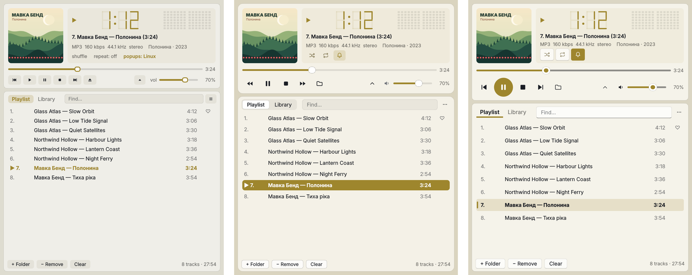
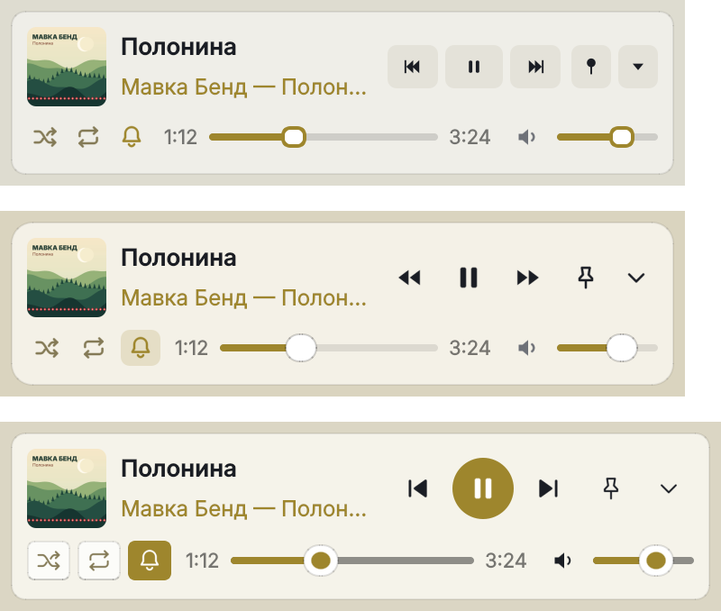

## What's new / Що нового

**English**

- **Three skins**: Plativka's own look, **macOS** or **Windows 11** (☰ → View → Skin, or `Shift+T`). The layout stays the same; the buttons, icons, sliders, tabs, the playing-track highlight and the translucency follow the chosen system. The colour from the album cover tints the window in every skin. Switches at once, without a restart.
- **macOS skin on a Mac**: the desktop shows through the window, blurred, like in Finder and Music.
- **Smaller compact view and mini player**: two rows instead of three — the cover, the title and ⏮ ⏯ ⏭ on top; the switches as icons, the seek bar with the time and the volume below. The mini player is about half the size; the window with the playlist can be made about 100 px narrower. Stop and Add folder are in the menu and on the keys (`V`, `L`).
- Switching between the full and the compact view no longer stretches the window to its old height.

**Українська**

- **Три скіни**: власний вигляд Платівки, **macOS** або **Windows 11** (☰ → Вигляд → Скін або `Shift+T`). Розташування те саме; кнопки, іконки, повзунки, вкладки, виділення треку, що грає, і прозорість — як у вибраній системі. Колір з обкладинки підфарбовує вікно в кожному скіні. Перемикається одразу, без перезапуску.
- **Скін «macOS» на Mac**: крізь вікно розмито видно робочий стіл, як у Finder і Музиці.
- **Менші компактний вигляд і міні-плеєр**: два ряди замість трьох — обкладинка, назва й ⏮ ⏯ ⏭ угорі; перемикачі іконками, смуга перемотування з часом і гучність унизу. Міні-плеєр приблизно вдвічі менший, вікно зі списком можна зробити вужчим десь на 100 px. Стоп і «Додати теку» — у меню й на клавішах (`V`, `L`).
- Перемикання між повним і компактним виглядом більше не розтягує вікно до старої висоти.

**How to use / Як користуватися:** skins — **☰ → View → Skin** (on a Mac: the View menu) or `Shift+T`; compact view — `W`, mini player — `E`. Скіни — **☰ → Вигляд → Скін** (на Mac — меню «Вигляд») або `Shift+T`; компактний вигляд — `W`, міні-плеєр — `E`. [Guide](https://github.com/dkindratyuk-web/plativka/blob/main/docs/en/desktop.md#skins) · [Інструкція](https://github.com/dkindratyuk-web/plativka/blob/main/docs/uk/desktop.md#скіни)

## Download / Завантажити

| | Terminal version / Консольна | Desktop / Віконна |
|---|---|---|
| macOS · Apple Silicon | `Plativka-{{VERSION}}-macos-arm64.dmg` | `Plativka-Desktop-{{VERSION}}-macos-arm64.dmg` |
| macOS · Intel | `Plativka-{{VERSION}}-macos-x86_64.dmg` | `Plativka-Desktop-{{VERSION}}-macos-x86_64.dmg` |
| Windows 10/11 | `Plativka-{{VERSION}}-windows-x64-setup.exe` | `Plativka-Desktop-{{VERSION}}-windows-x64-setup.exe` |
| Linux | `plativka-{{VERSION}}-linux.tar.gz` → `./install.sh` | same archive → `./install.sh --desktop` |

The desktop DMG opens like the terminal one: the first time, allow it in System Settings → Privacy & Security → "Open Anyway". / Віконний DMG відкривається так само: першого разу дозвольте в «Системні параметри → Приватність і безпека → Усе одно відкрити».

Installation guides / Інструкції: [macOS](https://github.com/dkindratyuk-web/plativka/blob/main/docs/en/install-macos.md) · [Windows](https://github.com/dkindratyuk-web/plativka/blob/main/docs/en/install-windows.md) · [Linux](https://github.com/dkindratyuk-web/plativka/blob/main/docs/en/install-linux.md)
