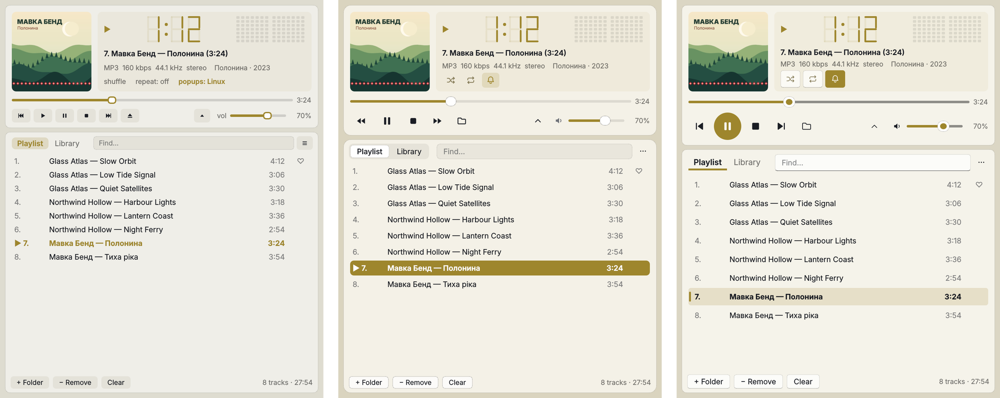
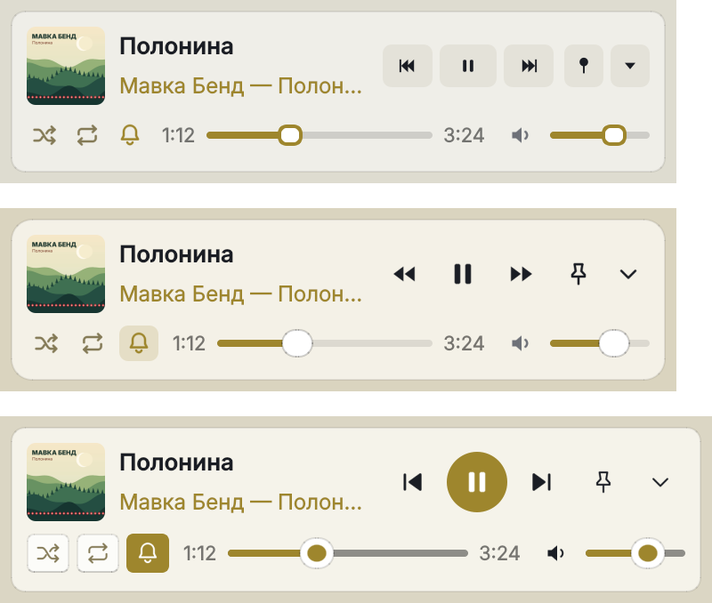

## What's new / Що нового

**English**

- Skins: the cards stand out from the window again — in the macOS and Windows 11 skins the window and the panels had almost the same colour, so the buttons and the playlist blended together. The Plativka skin has not changed.
- macOS skin on a Mac: the window background is now light enough for the blurred desktop to show through.
- The playing track stays readable when it is also selected (it was dark text on a dark bar in the macOS skin).
- The speaker icon next to the volume mutes the sound, and a second click brings the previous volume back.

**Українська**

- Скіни: картки знову помітно виділяються на тлі вікна — у скінах macOS і Windows 11 вікно й панелі мали майже однаковий колір, тож кнопки й список зливалися. Скін «Платівка» не змінився.
- Скін «macOS» на Mac: фон вікна тепер достатньо прозорий, щоб крізь нього було видно розмитий робочий стіл.
- Трек, що грає, читається, навіть коли він ще й виділений (у скіні macOS був темний текст на темній плашці).
- Іконка динаміка біля гучності вимикає звук, а другий клік повертає попередню гучність.

**How to use / Як користуватися:** skins — **☰ → View → Skin** (on a Mac: the View menu) or `Shift+T`; compact view — `W`, mini player — `E`. Скіни — **☰ → Вигляд → Скін** (на Mac — меню «Вигляд») або `Shift+T`; компактний вигляд — `W`, міні-плеєр — `E`. [Guide](https://github.com/dkindratyuk-web/plativka/blob/main/docs/en/desktop.md#skins) · [Інструкція](https://github.com/dkindratyuk-web/plativka/blob/main/docs/uk/desktop.md#скіни)

## Download / Завантажити

| | Terminal version / Консольна | Desktop / Віконна |
|---|---|---|
| macOS · Apple Silicon | `Plativka-{{VERSION}}-macos-arm64.dmg` | `Plativka-Desktop-{{VERSION}}-macos-arm64.dmg` |
| macOS · Intel | `Plativka-{{VERSION}}-macos-x86_64.dmg` | `Plativka-Desktop-{{VERSION}}-macos-x86_64.dmg` |
| Windows 10/11 | `Plativka-{{VERSION}}-windows-x64-setup.exe` | `Plativka-Desktop-{{VERSION}}-windows-x64-setup.exe` |
| Linux | `plativka-{{VERSION}}-linux.tar.gz` → `./install.sh` | same archive → `./install.sh --desktop` |

The desktop DMG opens like the terminal one: the first time, allow it in System Settings → Privacy & Security → "Open Anyway". / Віконний DMG відкривається так само: першого разу дозвольте в «Системні параметри → Приватність і безпека → Усе одно відкрити».

Installation guides / Інструкції: [macOS](https://github.com/dkindratyuk-web/plativka/blob/main/docs/en/install-macos.md) · [Windows](https://github.com/dkindratyuk-web/plativka/blob/main/docs/en/install-windows.md) · [Linux](https://github.com/dkindratyuk-web/plativka/blob/main/docs/en/install-linux.md)
