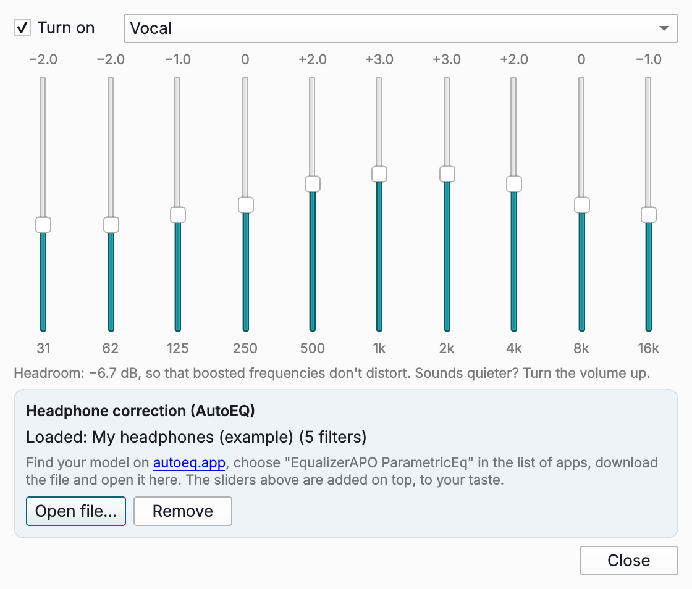

## What's new / Що нового

**English**

- **Equalizer** (☰ → Playback → Equalizer…, or `Shift+E`): 10 bands from 31 Hz to 16 kHz, presets (More bass, Vocal, Rock, Quiet listening and more), and **automatic headroom** — Plativka works out the peak of your curve and lowers the level by exactly that much, so boosted frequencies never distort. The sound changes as you move a slider; **eq** next to the switches shows it is on.
- **Headphone correction from AutoEQ**: open the `ParametricEQ.txt` for your model from autoeq.app (choose *EqualizerAPO ParametricEq*), and your headphones get closer to a neutral sound. The sliders still work on top. [How to use it](https://github.com/dkindratyuk-web/plativka/blob/main/docs/en/desktop.md#equalizer).
- The level meter shows the sound after the equalizer, i.e. what you hear.
- macOS skin on a Mac: the panels are more translucent, so the blurred desktop shows through.
- Long playlists: the number of the playing track is no longer cut (▶ 485. instead of ▶ 4…).

**Українська**

- **Еквалайзер** (☰ → Відтворення → Еквалайзер… або `Shift+E`): 10 смуг від 31 Гц до 16 кГц, готові налаштування (Більше басу, Голос, Рок, Тихе прослуховування та інші) і **автоматичний запас гучності** — Платівка рахує найвищу точку вашої кривої й зменшує рівень рівно настільки, тож підсилені частоти не спотворюються. Звук змінюється, щойно рухаєте повзунок; **екв** поруч із перемикачами показує, що його увімкнено.
- **Корекція навушників з AutoEQ**: відкрийте `ParametricEQ.txt` для своєї моделі з autoeq.app (оберіть *EqualizerAPO ParametricEq*) — навушники звучатимуть ближче до нейтрального. Повзунки працюють і далі, поверх корекції. [Як користуватися](https://github.com/dkindratyuk-web/plativka/blob/main/docs/uk/desktop.md#еквалайзер).
- Індикатор рівня показує звук після еквалайзера — те, що ви чуєте.
- Скін «macOS» на Mac: панелі прозоріші, крізь них видно розмитий робочий стіл.
- Довгі списки: номер треку, що грає, більше не обрізається («▶ 485.» замість «▶ 4…»).

**How to use / Як користуватися:** equalizer — **☰ → Playback → Equalizer…** (on a Mac: the Playback menu) or `Shift+E`; headphone correction — **Open file…** in the equalizer window. Еквалайзер — **☰ → Відтворення → Еквалайзер…** (на Mac — меню «Відтворення») або `Shift+E`; корекція навушників — **Відкрити файл…** у вікні еквалайзера. [Guide](https://github.com/dkindratyuk-web/plativka/blob/main/docs/en/desktop.md#equalizer) · [Інструкція](https://github.com/dkindratyuk-web/plativka/blob/main/docs/uk/desktop.md#еквалайзер)

## Download / Завантажити

| | Terminal version / Консольна | Desktop / Віконна |
|---|---|---|
| macOS · Apple Silicon | `Plativka-{{VERSION}}-macos-arm64.dmg` | `Plativka-Desktop-{{VERSION}}-macos-arm64.dmg` |
| macOS · Intel | `Plativka-{{VERSION}}-macos-x86_64.dmg` | `Plativka-Desktop-{{VERSION}}-macos-x86_64.dmg` |
| Windows 10/11 | `Plativka-{{VERSION}}-windows-x64-setup.exe` | `Plativka-Desktop-{{VERSION}}-windows-x64-setup.exe` |
| Linux | `plativka-{{VERSION}}-linux.tar.gz` → `./install.sh` | same archive → `./install.sh --desktop` |

The desktop DMG opens like the terminal one: the first time, allow it in System Settings → Privacy & Security → "Open Anyway". / Віконний DMG відкривається так само: першого разу дозвольте в «Системні параметри → Приватність і безпека → Усе одно відкрити».

Installation guides / Інструкції: [macOS](https://github.com/dkindratyuk-web/plativka/blob/main/docs/en/install-macos.md) · [Windows](https://github.com/dkindratyuk-web/plativka/blob/main/docs/en/install-windows.md) · [Linux](https://github.com/dkindratyuk-web/plativka/blob/main/docs/en/install-linux.md)
