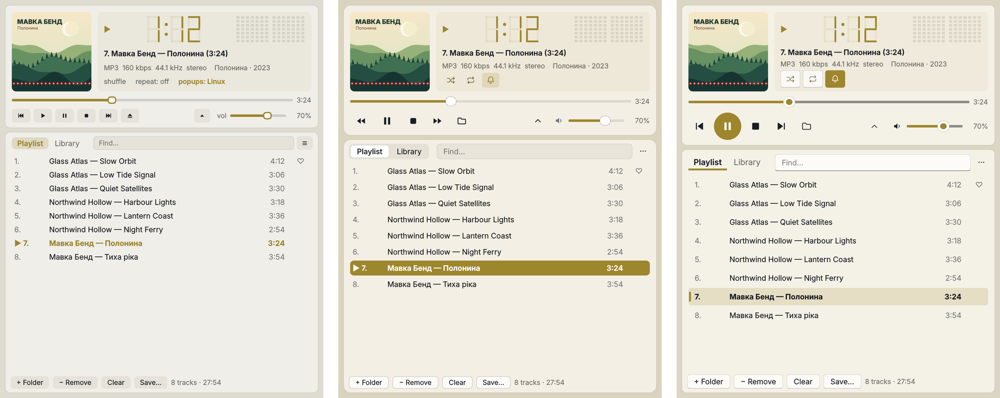

## What's new / Що нового

**English**

- **Saved playlists**: keep "For the car", "Work" and more. **Save…** under the playlist or `Ctrl+S` (`Ctrl+Shift+S` — under a new name); open them from **Library → ▤ Playlists**; rename or delete with a right-click (the file goes to the Trash, the music stays). **☰ → File → Open an M3U playlist…** opens lists from other players. Playlists are ordinary M3U8 files, so VLC and others can open them too. [How to use it](https://github.com/dkindratyuk-web/plativka/blob/main/docs/en/desktop.md#saved-playlists)
- **The title bar takes the colour of the window on a Mac**, in every skin: the window is one piece, the cover colour reaches the very top. In the macOS skin it is filled with the same translucent material. (The blurred desktop appears from the next start after switching to the macOS skin.)
- **The cover colour is clearly visible again** in the window background, the playlist and the buttons, in all skins — like on Windows 11 with Mica.
- Compact view: the level meter is back when the window is wide enough; the shuffle, repeat and notification icons and the buttons are tinted by the cover.
- The status line no longer shows a white strip; the time of the playing track and long track numbers are no longer cut; no grey patch when hovering over the playing track.

**Українська**

- **Збережені списки**: «Для машини», «Робота» та інші. **Зберегти…** під списком або `Ctrl+S` (`Ctrl+Shift+S` — під новою назвою); відкриваються з **Медіатека → ▤ Списки відтворення**; перейменувати чи видалити — правим кліком (файл іде в Кошик, музика лишається). **☰ → Файл → Відкрити список M3U…** відкриває списки з інших плеєрів. Списки — звичайні файли M3U8, тож їх відкриють і VLC та інші. [Як користуватися](https://github.com/dkindratyuk-web/plativka/blob/main/docs/uk/desktop.md#збережені-списки)
- **Заголовок вікна на Mac — того ж кольору, що й вікно**, у кожному скіні: вікно — одне ціле, колір обкладинки доходить до самого верху. У скіні «macOS» він залитий тим самим напівпрозорим матеріалом. (Розмитий робочий стіл з'являється з наступного запуску після перемикання на скін «macOS».)
- **Колір обкладинки знову добре помітний** у фоні вікна, списку й кнопках, у всіх скінах — як на Windows 11 з Mica.
- Компактний вигляд: індикатор рівня повернувся, коли вікно досить широке; іконки «перемішати», «повтор», «сповіщення» і кнопки підфарбовані кольором обкладинки.
- Рядок повідомлень більше не біла смуга; час треку, що грає, і довгі номери не обрізаються; без сірої плями під курсором на треку, що грає.

**How to use / Як користуватися:** save a playlist — **Save…** under the list or `Ctrl+S`; open — **Library → ▤ Playlists**; skins — `Shift+T`. Зберегти список — **Зберегти…** під списком або `Ctrl+S`; відкрити — **Медіатека → ▤ Списки відтворення**; скіни — `Shift+T`. [Guide](https://github.com/dkindratyuk-web/plativka/blob/main/docs/en/desktop.md#saved-playlists) · [Інструкція](https://github.com/dkindratyuk-web/plativka/blob/main/docs/uk/desktop.md#збережені-списки)

## Download / Завантажити

| | Terminal version / Консольна | Desktop / Віконна |
|---|---|---|
| macOS · Apple Silicon | `Plativka-{{VERSION}}-macos-arm64.dmg` | `Plativka-Desktop-{{VERSION}}-macos-arm64.dmg` |
| macOS · Intel | `Plativka-{{VERSION}}-macos-x86_64.dmg` | `Plativka-Desktop-{{VERSION}}-macos-x86_64.dmg` |
| Windows 10/11 | `Plativka-{{VERSION}}-windows-x64-setup.exe` | `Plativka-Desktop-{{VERSION}}-windows-x64-setup.exe` |
| Linux | `plativka-{{VERSION}}-linux.tar.gz` → `./install.sh` | same archive → `./install.sh --desktop` |

The desktop DMG opens like the terminal one: the first time, allow it in System Settings → Privacy & Security → "Open Anyway". / Віконний DMG відкривається так само: першого разу дозвольте в «Системні параметри → Приватність і безпека → Усе одно відкрити».

Installation guides / Інструкції: [macOS](https://github.com/dkindratyuk-web/plativka/blob/main/docs/en/install-macos.md) · [Windows](https://github.com/dkindratyuk-web/plativka/blob/main/docs/en/install-windows.md) · [Linux](https://github.com/dkindratyuk-web/plativka/blob/main/docs/en/install-linux.md)
