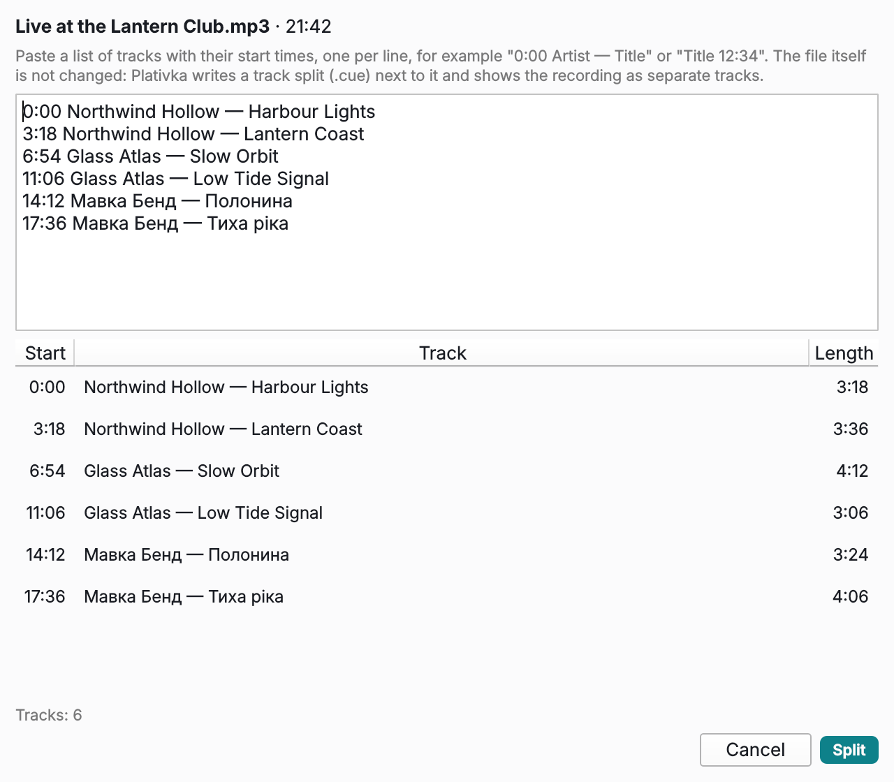

## What's new / Що нового

**English**

- **A long recording as tracks**: a vinyl rip, a concert, a DJ set or a lecture in one file? Right-click it in the playlist → **Split into tracks…**, paste its track list with times (`0:00 Artist — Title`, `Title 12:34`…), check the preview and press **Split**. Plativka writes a `.cue` next to the file — the file itself is not changed — and the recording plays as separate tracks: favorites, queue, USB copy and the remote work with them. A playing recording carries on without a break. **Edit the track split…** / **Remove the split** to change it. [How to use it](https://github.com/dkindratyuk-web/plativka/blob/main/docs/en/desktop.md#a-long-recording-as-tracks)
- **Single files to the playlist**: **+ Add → Files…** (or ⏏, or `Ctrl+Shift+O`) adds chosen tracks to the end of the playlist without adding a whole folder.
- AutoEQ: the option on autoeq.app is called *EqualizerAPO Parametric Eq* — the hint now says so.
- CUE files on Windows are matched to their audio file regardless of slash style.

**Українська**

- **Довгий запис — окремими треками**: оцифрована платівка, концерт, DJ-сет чи лекція одним файлом? Правий клік у списку → **Розбити на треки…**, вставте список треків із часом (`0:00 Виконавець — Назва`, `Назва 12:34`…), перевірте попередній перегляд і натисніть **Розбити**. Платівка пише поруч `.cue` — сам файл не змінюється, — і запис грає окремими треками: улюблені, черга, копіювання на флешку й пульт працюють із ними. Запис, що грає, продовжує без паузи. Змінити — **Змінити розбивку на треки…** / **Прибрати розбивку**. [Як користуватися](https://github.com/dkindratyuk-web/plativka/blob/main/docs/uk/desktop.md#довгий-запис--окремими-треками)
- **Окремі файли в список**: **+ Додати → Файли…** (або ⏏, або `Ctrl+Shift+O`) додає вибрані треки в кінець списку, без цілої теки.
- AutoEQ: пункт на autoeq.app називається *EqualizerAPO Parametric Eq* — підказка тепер так і каже.
- Файли CUE на Windows знаходять свій аудіофайл незалежно від того, які скісні риски в шляху.

**How to use / Як користуватися:** split a recording — right-click it in the playlist → **Split into tracks…**; add files — **+ Add → Files…** or `Ctrl+Shift+O`. Розбити запис — правий клік у списку → **Розбити на треки…**; додати файли — **+ Додати → Файли…** або `Ctrl+Shift+O`. [Guide](https://github.com/dkindratyuk-web/plativka/blob/main/docs/en/desktop.md#a-long-recording-as-tracks) · [Інструкція](https://github.com/dkindratyuk-web/plativka/blob/main/docs/uk/desktop.md#довгий-запис--окремими-треками)

## Download / Завантажити

| | Terminal version / Консольна | Desktop / Віконна |
|---|---|---|
| macOS · Apple Silicon | `Plativka-{{VERSION}}-macos-arm64.dmg` | `Plativka-Desktop-{{VERSION}}-macos-arm64.dmg` |
| macOS · Intel | `Plativka-{{VERSION}}-macos-x86_64.dmg` | `Plativka-Desktop-{{VERSION}}-macos-x86_64.dmg` |
| Windows 10/11 | `Plativka-{{VERSION}}-windows-x64-setup.exe` | `Plativka-Desktop-{{VERSION}}-windows-x64-setup.exe` |
| Linux | `plativka-{{VERSION}}-linux.tar.gz` → `./install.sh` | same archive → `./install.sh --desktop` |

The desktop DMG opens like the terminal one: the first time, allow it in System Settings → Privacy & Security → "Open Anyway". / Віконний DMG відкривається так само: першого разу дозвольте в «Системні параметри → Приватність і безпека → Усе одно відкрити».

Installation guides / Інструкції: [macOS](https://github.com/dkindratyuk-web/plativka/blob/main/docs/en/install-macos.md) · [Windows](https://github.com/dkindratyuk-web/plativka/blob/main/docs/en/install-windows.md) · [Linux](https://github.com/dkindratyuk-web/plativka/blob/main/docs/en/install-linux.md)
