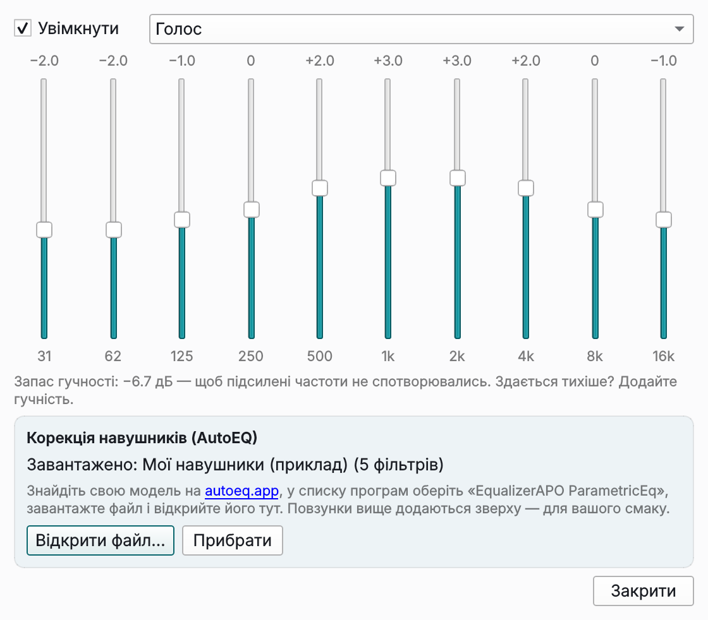
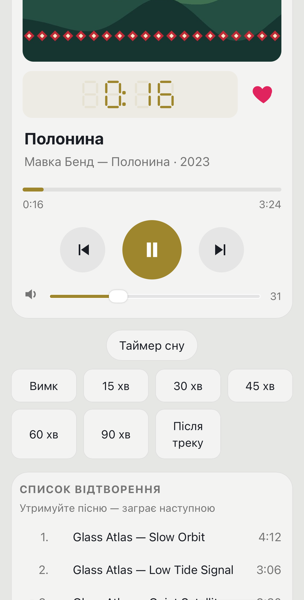
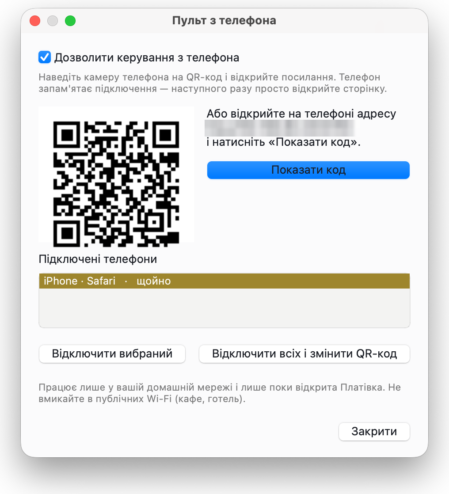

# Як користуватися віконною Платівкою

[English](../en/desktop.md) · [До README](../../README.uk.md) · [Консольна версія](terminal.md)

Віконна Платівка — основна версія Платівки: звичайне вікно програми для macOS, Windows і Linux. Встановлення: [macOS](install-macos.md) · [Windows](install-windows.md) · [Linux](install-linux.md).

## Вікно

Згори вниз:

- **Плеєр**: обкладинка альбому, табло з великим годинником, візуалізація звуку, назва треку і його формат (MP3, бітрейт, частота, альбом, рік), перемикачі **перемішати · повтор · сповіщення**, смуга перемотування, кнопки ⏮ ▶ ⏸ ⏹ ⏭ ⏏ і гучність.
- **Вкладки** — **Список відтворення** і **Медіатека** — з полем пошуку та меню **☰** (на macOS меню — у рядку меню вгорі екрана).

Майже все клікається: перемикачі перемикаються, клік по смузі перемотування переносить туди, клік по годиннику показує час, що залишився, замість зіграного, клік по обкладинці перемикає повний і компактний вигляд, ⏏ додає теку одразу в список відтворення.

**Візуалізація звуку**: вертикальні «світлодіодні» стовпчики. Ліва половина — лівий канал, права — правий; те, що грає *зараз*, — посередині, а останні секунди поступово відходять до країв і блякнуть. На гучних місцях верхні сегменти світяться жовтим і червоним.

**Кольори**: годинник, візуалізація, фон вікна, панелі й виділений трек беруть колір з обкладинки альбому. **T** перемикає тему: як у системі → світла → темна. На Windows 11 вікно має напівпрозорий фон Mica, підфарбований обкладинкою.

## Скіни

У Платівки три скіни: **Платівка** (власний вигляд), **macOS** і **Windows 11**. Розташування в усіх однакове — обкладинка, годинник, перемикачі, кнопки й список на своїх місцях; змінюється лише вигляд елементів:

| | Платівка | macOS | Windows 11 |
|---|---|---|---|
| Кнопки | маленькі сірі квадратики | без рамок, іконки як SF Symbols | іконки Fluent, кругла кнопка **грати/пауза** кольору обкладинки |
| Перемішати · повтор · сповіщення | словами | іконками, увімкнені — на легкому тлі кольору обкладинки | кнопками-перемикачами, увімкнені залиті кольором обкладинки |
| Повзунки | тонкі, з кільцем | тонкі, з білою кулькою | Fluent, з крапкою кольору обкладинки |
| Вкладки й пошук | пласкі | сегментований перемикач і заокруглене поле пошуку | риска під активною вкладкою |
| Трек, що грає | жирним, кольором обкладинки | заокруглена плашка кольору обкладинки | легка плашка й коротка риска зліва |
| Прозорість | — | на Mac крізь вікно розмито видно робочий стіл | Mica на Windows 11 |

Колір з обкладинки працює в кожному скіні: ним підфарбовані вікно, панелі, годинник і трек, що грає.

Скін перемикається в **☰ → Вигляд → Скін** (на Mac — меню **Вигляд**) або клавішею **Shift+T**. Вікно змінюється одразу, без перезапуску; скін запам'ятовується. Будь-який скін працює на будь-якій системі: скін «macOS» на Windows чи Linux просто має суцільний фон замість розмиття.

З версії 1.8 на Mac скін «macOS» заливає тим самим напівпрозорим матеріалом і **заголовок вікна**, як у Finder і Музиці: вікно — одне ціле, кнопки вікна лежать поверх. Тягніть вікно за смугу вгорі, як звичайно; подвійний клік там розгортає його.

## Три розміри

| | Як увімкнути | Що видно |
|---|---|---|
| **Повний вигляд** | за замовчуванням, **W** — повернутися | велика обкладинка, великий годинник, внизу список і медіатека |
| **Компактний** | **W** або клік по обкладинці | два ряди над списком: обкладинка, назва й ⏮ ⏯ ⏭; далі перемішати · повтор · сповіщення, смуга перемотування з часом і гучність |
| **Міні-плеєр** | **E** або кнопка **▴** | лише ці два ряди — вікно зменшується до них |

З версії 1.6 компактний вигляд і міні-плеєр менші: одна кнопка **грати/пауза** замість двох, перемикачі іконками, гучність без підпису (відсоток — у підказці). **Стоп** і **Додати теку** — у меню й на клавішах (**V**, **L**).

У компактному вигляді й міні-плеєрі кнопка **📌** (або **Ctrl+T**) тримає вікно поверх усіх інших — зручно для міні-плеєра в куті екрана. **E** або **▾** повертає вікну попередню висоту; клік по вкладці — теж. Вигляд, розмір і місце вікна запам'ятовуються.

## Як додати музику

Платівка ніколи не копіює й не змінює ваші файли — лише читає їх.

- **L**, **Ctrl+O** або **+ Тека** на вкладці «Медіатека» відкриває звичайне системне вікно вибору теки. Теки додаються в **медіатеку**.
- **Перетягування**: перетягніть теки з Finder / Провідника / файлового менеджера у вікно — вони потраплять у медіатеку; окремі аудіофайли — в кінець списку відтворення.
- **⏏** або **+ Тека** на вкладці «Список відтворення» додає теку одразу в список, не додаючи її до медіатеки.
- **Теки…** (вкладка «Медіатека» або **☰ → Файл**) показує теки медіатеки з кількістю треків у кожній: позначте теки й натисніть **Прибрати позначені** або **Прибрати всі**; **+ Додати…** додає ще. Файли на диску лишаються.
- **↻** пересканує медіатеку, коли ви доклали файли в теку.

Формати: MP3, FLAC, M4A/AAC/ALAC, OGG/Opus, WAV, AIFF, WMA. Теги читаються з файлів; файли без тегів розбираються з імені (`01. Виконавець - Назва.mp3`), а старі теги в кодуванні Windows-1251 («кракозябри» на кшталт «Ïðèâ³ò») виправляються автоматично. Обкладинки беруться з файлів або з `cover.jpg` / `folder.jpg` / `front.jpg` поруч.

## Медіатека і список

Вкладка **Медіатека** показує музику за **Виконавцями** (виконавець → альбом → треки) або за **Теками** — перемикається двома кнопками над списком.

| У медіатеці | Що станеться |
|---|---|
| подвійний клік по треку (або **Enter**) | увесь його альбом/тека йде в список, грає цей трек |
| подвійний клік по виконавцю, альбому чи теці | він замінює список і починає грати |
| правий клік → **Додати в кінець списку** | додає вибране, не зупиняючи музику |
| **▶ Усе** | уся медіатека в список (з випадкового треку, якщо ввімкнено перемішування) |

На вкладці **Список відтворення**: подвійний клік або **Enter** грає трек, **Delete** (або **− Прибрати**) прибирає виділені треки, **Очистити** спорожнює список. Трек, що грає, позначено ▶ і виділено кольором обкладинки.

**Пошук**: **J**, **/** або **Ctrl+F** — перейти в поле пошуку; воно фільтрує поточну вкладку, поки ви друкуєте. **Enter** у полі пошуку грає перший збіг у списку або переходить до нього в медіатеці. **Esc** очищає пошук.

## Збережені списки

*З'явиться у версії 1.8.*

Тримайте кілька списків відтворення («Для машини», «Робота», «Вечір») і перемикайтеся між ними.

| | Як |
|---|---|
| **Зберегти** поточний список | **Зберегти…** під списком, **Ctrl+S** або **☰ → Файл → Зберегти список** — введіть назву |
| **Зберегти під новою назвою** | **Ctrl+Shift+S** або **☰ → Файл → Зберегти список як…** |
| **Відкрити** збережений список | **Медіатека** → **▤ Списки відтворення** нагорі → подвійний клік по назві (він замінює поточний список і починає грати) |
| **Додати** збережений список у кінець | правий клік по назві → **Додати в кінець списку** |
| **Перейменувати / видалити** | правий клік по назві → **Перейменувати…** / **Видалити…** (файл піде в Кошик, сама музика лишиться) |
| **Відкрити M3U** з іншого плеєра | **☰ → Файл → Відкрити список M3U…** |

Коли відкрито збережений список, його назва видна під списком («Для машини · 24 треки · 1:32:10»), і **Ctrl+S** зберігає ваші зміни в нього без питань. Будь-яка дія, що замінює весь список (альбом із медіатеки, **▶ Усе**, **Очистити**), робить його знову новим, незбереженим.

Списки — звичайні файли **M3U8** у теці налаштувань Платівки (`playlists`, див. [Де Платівка зберігає дані](#де-платівка-зберігає-дані)), тож їх відкриють і VLC, foobar2000 та інші плеєри. Треки з альбомів із файлом `.cue` розуміє лише Платівка. Відсутні файли під час відкриття пропускаються, і Платівка каже, скільки їх.

## Відтворення

| Клавіша | Дія |
|---|---|
| `Пробіл` або `X` | грати / пауза |
| `Z` · `B` (а також `F7` · `F9`, `Ctrl+←` · `Ctrl+→`) | попередній · наступний трек |
| `C` (`F8`) · `V` | пауза · стоп |
| `←` `→` | перемотати на 5 секунд |
| `+` `−` | гучність |
| `S` | перемішування увімк / вимк |
| `R` | повтор: вимк → усе → один |
| `N` | сповіщення про трек увімк / вимк |
| `F` · `Shift+F` | вподобати · грати лише улюблені |
| `Shift+N` | грати наступним (виділені треки) |
| `Tab` · `1` · `2` | перемкнути вкладку |
| `F1` | про Платівку |
| `Q`, `Ctrl+Q` (`⌘Q`) | вийти |

**Гучність** дзеркалить системну: клавіші гучності на клавіатурі рухають повзунок, а повзунок змінює гучність системи. На Linux для цього потрібен PipeWire (`wpctl`) або PulseAudio (`pactl`) — вони є в кожному сучасному робочому середовищі.

«Назад» повертає на початок поточного треку, якщо зіграно понад 3 секунди, інакше — на попередній трек (у режимі перемішування — на той, що справді грав перед ним). Наприкінці списку Платівка зупиняється; щоб грати по колу, увімкніть **повтор: все**.

### Таймер сну

Платівка може сама вимкнути музику: у ☰ → **Відтворення → Таймер сну** (на Mac — меню **Відтворення**) оберіть 15, 30, 45, 60 чи 90 хвилин або **після цього треку**. Поки таймер працює, поруч із перемішуванням і повтором видно, скільки лишилося (**сон: 29:41**; клацніть, щоб скасувати). Коли час вийде, музика за кілька секунд м'яко стихне й стане на паузу.

### Без пауз між треками й вирівнювання гучності

Треки йдуть один за одним без паузи, як на альбомі, — концертні записи й діджейські мікси не розриваються на шматки. Вмикати нічого не треба.

**Вирівнювання гучності (ReplayGain)** робить так, щоб тихі й гучні альбоми грали однаково голосно, якщо у файлах є теги ReplayGain (їх додає більшість рипів і магазинів; додати можна в foobar2000, MusicBrainz Picard тощо). Режим — у ☰ → **Відтворення → Вирівнювання гучності (ReplayGain)**: за альбомом (типово), за треком або вимкнено. **За альбомом** зберігає різницю між тихими й гучними піснями одного альбому, як задумав виконавець; **за треком** робить кожну пісню однаково гучною. Файли без цих тегів грають як є.

### Альбом одним файлом з .cue

Якщо альбом — це один великий файл FLAC, APE чи WAV, а поруч лежить `.cue`, Платівка покаже його окремими треками з назвами, і вони гратимуть один за одним без пауз. Файл `.cue` може бути в UTF-8 або в старому кодуванні Windows (кириличні `.cue` з 2000-х теж).

## Еквалайзер

**☰ → Відтворення → Еквалайзер…** (на Mac — меню **Відтворення**) або **Shift+E**. Звук змінюється, щойно рухаєте повзунок; вікно може лишатися відкритим, поки грає музика.

### Готові налаштування й повзунки

- **Увімкнути** — еквалайзер вмикається й вимикається. Вимкніть і ввімкніть кілька разів, щоб почути різницю: це найчесніший спосіб оцінити налаштування.
- **Готові налаштування**: Рівно, Більше басу, Більше високих, Голос, Рок, Поп, Електроніка, Класика і **Тихе прослуховування** (на малій гучності вухо гірше чує найнижчі й найвищі звуки; це налаштування трохи їх повертає).
- **10 повзунків** від 31 Гц до 16 кГц, по ±12 дБ. Варто посунути один — налаштування стає *Власним*. Подвійний клік по повзунку повертає його на 0.
- Коли еквалайзер увімкнено, поруч із перемикачами «перемішати» й «повтор» видно **екв**; клік відкриває вікно. **☰ → Відтворення → Еквалайзер увімкнено** перемикає його, не відкриваючи вікна.

Приблизно за що відповідають смуги: 31–62 Гц — глибокий бас, який більше відчуваєш, ніж чуєш; 125–250 Гц — «тіло» басу й барабанів (забагато — гуде); 500 Гц–2 кГц — голос і більшість інструментів; 4 кГц — чіткість і атака (забагато — ріже вуха); 8–16 кГц — «повітря» й тарілки.

### Запас гучності: чому стає трохи тихіше

Якщо підняти частоту на 6 дБ, найгучніші місця пісні виходять за максимум, і звук спотворюється (кліпінг). Платівка цього не допускає: вона рахує найвищу точку всієї вашої кривої й зменшує загальний рівень рівно настільки. У вікні це видно як **Запас гучності: −6,7 дБ**. Тож із підсиленим басом музика трохи тихша — додайте гучності. Зменшення частот запасу не потребує, а з вимкненим еквалайзером нічого не зменшується.

### Корекція навушників (AutoEQ)

Кожна модель навушників змінює звук по-своєму: в одних забагато басу, в інших різкий пік близько 6 кГц. Відкритий проєкт [AutoEQ](https://autoeq.app) виміряв тисячі моделей і для кожної порахував налаштування еквалайзера, які наближають її звук до нейтрального еталона. Це числа з вимірювань, а не чийсь смак.

1. Відкрийте [autoeq.app](https://autoeq.app) і знайдіть свої навушники за назвою.
2. У списку програм-еквалайзерів оберіть **EqualizerAPO ParametricEq** і завантажте файл. Він називається на кшталт *Ваша модель ParametricEQ.txt*.
3. У Платівці: **Еквалайзер… → Відкрити файл…** і оберіть цей файл. У вікні з'явиться *Завантажено: Ваша модель (10 фільтрів)*, і еквалайзер увімкнеться.
4. Послухайте з увімкненим і вимкненим еквалайзером. Повзунки вище працюють і далі й додаються поверх корекції — для вашого смаку.

Що варто знати:

- Корекція — для **однієї моделі**. На інших навушниках чи колонках натисніть **Прибрати** (або вимкніть еквалайзер), інакше виправлятимете не те.
- В AutoEQ часто є кілька вимірювань однієї моделі (з різних лабораторій); підійде будь-яке, вони зазвичай близькі.
- Корекція не додасть деталей, яких немає в записі, і не зробить дешеві навушники дорогими: вона вирівнює їхній баланс частот. Найчастіше чути чіткіший голос і акуратніший бас.
- Платівка читає стандартний формат Equalizer APO, тож підійде й файл, зроблений іншою програмою в цьому форматі.

### Наскільки це точно

Еквалайзер використовує ті самі фільтри, що й більшість апаратних і програмних еквалайзерів (смуги-«дзвони» й полиці), усередині звукового рушія mpv, з обробкою з плаваючою комою. Власний розрахунок кривої й запасу гучності Платівка перевіряє в тестах із тим, що FFmpeg справді робить із тестовим тоном: розбіжність — не більше 0,3 дБ.

Еквалайзер є у віконній Платівці. Його налаштування й завантажена корекція запам'ятовуються.

## Улюблені

Вподобайте пісні, які любите, і слухайте лише їх — з усіх тек одразу.

- **Вподобати**: сердечко **♡** у рядку списку (воно з'являється на рядку під мишкою й на виділеному), `F`, **☰ → Улюблені → До улюблених / прибрати**, правий клік на треку, меню в треї або ♡ на пульті з телефона. Вподобані пісні позначені червоним **♥**; порожніх сердечок на кожному рядку немає — список лишається чистим.
- **Слухати лише улюблені**: `Shift+F`, **☰ → Улюблені → Грати лише улюблені** або подвійний клік на **♥ Улюблені** нагорі медіатеки.
- **Лайки не губляться.** Платівка пам'ятає пісню за виконавцем, назвою й тривалістю, а не лише за назвою файлу. Перенесли музику на інший диск чи перейменували файли? Після наступного сканування медіатеки лайк сам переїде на нове місце.
- **Розумні списки** нагорі медіатеки: **Нещодавно додані**, **Найчастіше слухаю**, **Давно не звучали** (місяць і більше). Вони будуються з історії прослуховувань, яка зберігається лише на вашому комп'ютері: пісня вважається прослуханою після 30 секунд.
- **Прибрати неулюблені…** (☰ → Улюблені або правий клік на теці/виконавці в медіатеці) — розчистити великий список чи теку: за замовчуванням лише зі списку (файли лишаються на диску); або зі списку й з диска — у Кошик, ніколи назавжди. Пісні, які ще жодного разу не звучали, за замовчуванням лишаються — щоб не викинути те, чого ще не чули.
- **Зберегти улюблені як M3U…** — файл плейлиста для іншого плеєра чи телефона.

## Грати наступним

Хочете почути певну пісню одразу після поточної, не ламаючи порядок списку? Виділіть її й натисніть `Shift+N` (або правий клік → **Грати наступним**). Працює й для цілого альбому чи виконавця в медіатеці: вони вставляються одразу після поточного треку.

- У черзі може чекати кілька пісень; та, яку додали останньою, заграє першою. Рядки в черзі позначені **→1**, **→2**… біля номера.
- Черга грає й з увімкненим перемішуванням, а потім перемішування продовжується.
- На пульті з телефона: утримуйте пісню в списку — вона заграє наступною.
- Правий клік на пісні в черзі → **Прибрати з черги**; **☰ → Відтворення → Очистити чергу** очищає її. Після виходу з програми черга не зберігається.

## Копіювати на флешку

Для машини, старого плеєра чи друга: **☰ → Файл → Копіювати список на флешку…** (або правий клік у списку). Оберіть флешку чи теку — Платівка спершу покаже, скільки це файлів і мегабайтів і скільки вільного місця, і лише потім копіює.

- **Нумерувати файли** (01, 02, …) — більшість магнітол грає файли за порядком назв, тож порядок вашого списку збережеться. Зніміть галочку, щоб лишити звичайні назви «Виконавець - Назва».
- **Нічого не перезаписується без питання**: якщо частина файлів уже там, оберіть **Пропустити наявні** (за замовчуванням) або **Замінити наявні**.
- Якщо не вміщається, Платівка скаже, скільки бракує, ще до копіювання.
- Назви робляться безпечними для будь-якої флешки (FAT32/exFAT): символи на кшталт `: ? " /` замінюються. Оригінали не змінюються. Альбоми одним файлом із `.cue` копіюються цілим файлом разом із `.cue`.

## Знайти дублікати

**☰ → Файл → Знайти дублікати…** (або правий клік у медіатеці) шукає в медіатеці й у списку:

- **однакові файли** — той самий файл у двох місцях (байт у байт);
- **ту саму пісню** в різних файлах — той самий виконавець і назва, тривалість ±3 секунди (наприклад, MP3 і FLAC того самого альбому). Ремастери з приміткою в дужках вважаються тією самою піснею; концертна версія іншої тривалості — ні.

У кожній групі видно копії з форматом, бітрейтом, розміром, ♥ і тим, скільки разів ви її слухали. Позначена галочкою копія лишається — за замовчуванням найкраща: улюблена, без втрат, з вищим бітрейтом, частіше слухана. Змініть галочки, якщо хочете лишити іншу (хоча б одна копія лишається завжди). Потім приберіть зайві **лише зі списку** (за замовчуванням) або **в Кошик** — ніколи назавжди.

## Обкладинки з інтернету

Якщо в треку немає обкладинки ні у файлі, ні `cover.jpg` поруч, Платівка може знайти її в інтернеті. **За замовчуванням вимкнено**: увімкніть **☰ → Вигляд → Шукати обкладинки в інтернеті**.

- Звідки: **MusicBrainz / Cover Art Archive** (відкрита музична база), запасний варіант — **Apple (iTunes)**.
- Береться лише **впевнений збіг**: виконавець і альбом мають збігтися (кирилиця й латиниця теж — «Океан Ельзи» = «Okean Elzy»). Сумнівну обкладинку Платівка сама не поставить.
- **Знайти обкладинку…** (☰ → Вигляд або правий клік на треку) показує до шести варіантів з обох джерел — оберіть самі. Галочка **Також зберегти як cover.jpg у теку з музикою** залишить її поруч із музикою для інших плеєрів.
- Знайдені обкладинки зберігаються в кеші Платівки й далі працюють без інтернету; файли з музикою не змінюються. Надсилається лише виконавець і назва альбому (або пісні) — більше нічого.

## Пульт з телефона

Керуйте Платівкою з телефона, не встаючи з дивана: пауза, наступний чи попередній трек, перемотування, гучність, таймер сну і будь-який трек зі списку. На телефон нічого встановлювати не треба — це вебсторінка, яку Платівка сама показує у вашій домашній мережі. Сторінка схожа на саму Платівку: підфарбована кольором обкладинки пісні, що грає, з тим самим годинником і кнопками, світла чи темна — як плеєр на комп'ютері.

1. Відкрийте ☰ → **Відтворення → Пульт з телефона…** (на Mac — меню **Відтворення**; коли пульт увімкнено, можна клацнути **пульт** поруч із перемішуванням і повтором) і поставте галочку **Дозволити керування з телефона**.
2. Наведіть камеру телефона на QR-код і відкрийте посилання. Усе — телефон підключено, і він це запам'ятає: наступного разу просто відкрийте ту саму сторінку (додайте її на головний екран: Safari → Поділитися → **На початковий екран**, Chrome → ⋮ → **Додати на головний екран**).
3. Якщо камера не читає код з екрана, відкрийте на телефоні адресу, вказану поруч, натисніть у Платівці **Показати код** і введіть 6-значний код на телефоні.

Телефон і комп'ютер мають бути в одній Wi-Fi-мережі. Першого разу macOS чи Windows можуть спитати, чи дозволити Платівці вхідні з'єднання, — дозвольте для приватних мереж.

Якщо сторінка не відкривається на телефоні, див. [Можливі проблеми](troubleshooting.md#пульт-з-телефона-не-відкривається-на-телефоні).

**Безпека.** Пульт вимкнено, доки ви самі його не ввімкнете, і він працює лише поки відкрита Платівка.

- Достукатися до нього можуть лише пристрої вашої домашньої мережі — запити з інтернету відкидаються, навіть якщо на роутері прокинуто порт.
- Телефон потрапляє всередину тільки через QR-код (довгий одноразовий ключ) або короткий код, який ви самі показали: він діє 2 хвилини, а після 5 неправильних спроб вимикається. Адресу, з якої підбирають код, блокуємо на 10 хвилин.
- Кожен телефон має свій ключ; Платівка зберігає лише його відбиток. У списку видно всі підключені телефони; **Відключити всіх і змінити QR-код** відключає всіх одразу.
- Пульт уміє лише керувати музикою — жодного доступу до файлів, налаштувань чи чогось іншого на комп'ютері.
- Усередині домашньої мережі сторінка працює по звичайному HTTP (справжній сертифікат для домашньої адреси отримати не можна). У Wi-Fi з паролем це нормально; у публічних мережах (кафе, готель) пульт не вмикайте.

## Сповіщення, медіаклавіші, трей

- **Сповіщення про трек** з обкладинкою з'являються, коли вікно у фоні або згорнуте до міні-плеєра. **N** або перемикач **сповіщ** вимикає їх.
  - macOS: уперше дозвольте сповіщення для «Plativka Desktop».
  - Windows: звичайне сповіщення Windows; новий трек замінює попереднє.
  - Linux: обкладинка — іконка сповіщення.
- **Медіаклавіші** ⏮ ⏯ ⏭ і кнопки навушників працюють на всіх трьох системах; «Зараз відтворюється» (macOS), панель мультимедіа Windows і віджет плеєра GNOME/KDE (MPRIS) показують трек і обкладинку.
- **Іконка в треї**: клік показує вікно; правий клік — грати/пауза, наступний, попередній і вихід. На Windows і Linux пункт **☰ → Вигляд → Згортати в трей** робить так, що ✕ і згортання ховають вікно в трей, а не закривають програму.

## Оновлення

Під час запуску й далі раз на 6 годин Платівка питає GitHub, чи вийшла нова версія. Якщо так, поруч із перемішуванням і повтором з'являється **⬆ 1.x.x** — клацніть, щоб відкрити сторінку завантаження. Сама програма нічого не завантажує й не встановлює і нічого про вас не надсилає. Перевірити зараз або вимкнути перевірку: ☰ → **Довідка → Перевірити оновлення…** / **Перевіряти оновлення автоматично** (на Mac — меню **Довідка** у рядку меню).

## Мова

**☰ → Вигляд → Мова** (на macOS — меню **Вигляд** вгорі екрана) перемикає українську й англійську; змінюється після перезапуску. За замовчуванням мова — як у системі.

## Де Платівка зберігає дані

| | Налаштування, список | Кеш медіатеки, журнали |
|---|---|---|
| macOS, Linux | `~/.config/plativka/desktop.json` | `~/.cache/plativka/` |
| Windows | `%APPDATA%\Plativka\desktop.json` | `%LOCALAPPDATA%\Plativka\cache\` |

Під час першого запуску віконна Платівка бере теки з музикою і список відтворення з консольної версії (якщо вона встановлена); далі налаштування в кожної версії свої. Кеш медіатеки спільний.

Улюблені й історія прослуховувань лежать поруч із налаштуваннями, у `favorites.json` і `history.json`, — спільні для обох версій. Обкладинки, знайдені в інтернеті, лежать у теці кешу, у `covers/`; її можна сміливо видалити. Збережені списки відтворення — у теці налаштувань, у `playlists/` (файли M3U8).

## Параметри командного рядка

`plativka-desktop --demo` — роздивитися без звуку й без mpv; `--lang=uk` / `--lang=en` — мова інтерфейсу.
